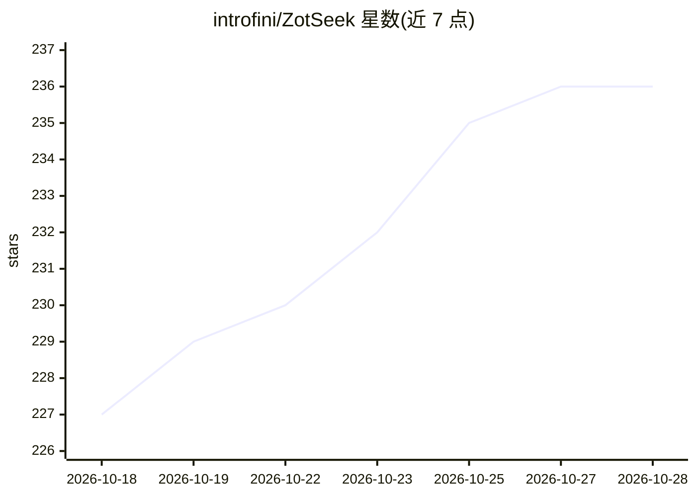

# introfini/ZotSeek

⭐ 236 · TypeScript · 推送 2026-10-08 · [GitHub](https://github.com/introfini/ZotSeek) · 个人维护 · 中文 README

**Zotero 的本地语义检索插件，内置 MCP 服务器供 AI agent 查文献**

面向 Zotero 用户的文献管理插件：将题录/摘要/PDF 全文按块生成 768 维本地嵌入向量（Transformers.js，默认模型约 130MB 随插件打包，可选 4 个本地模型），支持语义/关键词/RRF 混合检索、多查询 AND/OR 组合、相似文献发现、笔记索引与段落级定位，检索耗时宣称低于 100ms。另内置 MCP 服务器（默认关闭），让 Claude Code、Codex 等 MCP 客户端检索文献库并引用可跳转 PDF 页的链接。全部推理本地运行，零遥测；可选 LM Studio/Ollama/llama.cpp/vLLM 作为 localhost 推理服务（经环回地址白名单校验）。兼容 Zotero 8-10，UI 提供中英文。

## 筛选速览

| 维度 | 判定 | 备注 |
|---|---|---|
| AI 角色 | `ai-native` | 本体是模型或模型工具 |
| 许可风险 | `none` | — |
| 部署形态 | `desktop` | 安装包/桌面程序 |
| 模型依赖 | local-ok | 支持本地模型 |
| 硬件要求 | `cpu-ok` | |
| 安装摩擦 | `low` | 无编译、无系统依赖或容器化 |
| 成熟度 | — | 结构信号不足 |

## 能力要点

- 语义/关键词/RRF 混合检索，多查询 AND/OR 组合（最多 4 组）
- 内置 MCP 服务器，AI agent 可检索文献库并引用定位到 PDF 页的链接
- 默认嵌入模型本地打包（~130MB），离线运行，零网络请求（推理服务器为可选）
- 可选本地推理服务器：LM Studio / Ollama / llama.cpp / vLLM，仅限环回地址

## 适用场景

- 按含义而非关键词在大型 Zotero 文献库中查找论文
- 右键任一论文查找语义相关的研究
- 让 Claude Code / Codex 等 agent 通过 MCP 检索并引用自己的文献库
- 在无网络环境下对文献库做本地语义检索

## 场景标签

`语义搜索` `科研工具` · 领域:知识与检索

## 证据(README 行号)

> L3: Find similar papers by **meaning**, not just keywords. 100% local, no data leaves your machine. Now with a built-in 
> L16: - 🧠 **True Semantic Search** - Find papers by meaning, not just keywords
> L102:         A[📄 Paper] --> B[🤖 AI Model] --> C[768 numbers]

## 星数曲线

2026-10-18 227 → 2026-10-28 236（+9）

---
*卡片 v1 · prompt 1.4 · 生成 2026-10-22 · 置信度 high · 依据 README sha `362d7b1fb9bb` · [字段定义](../../DATASET.md)*
