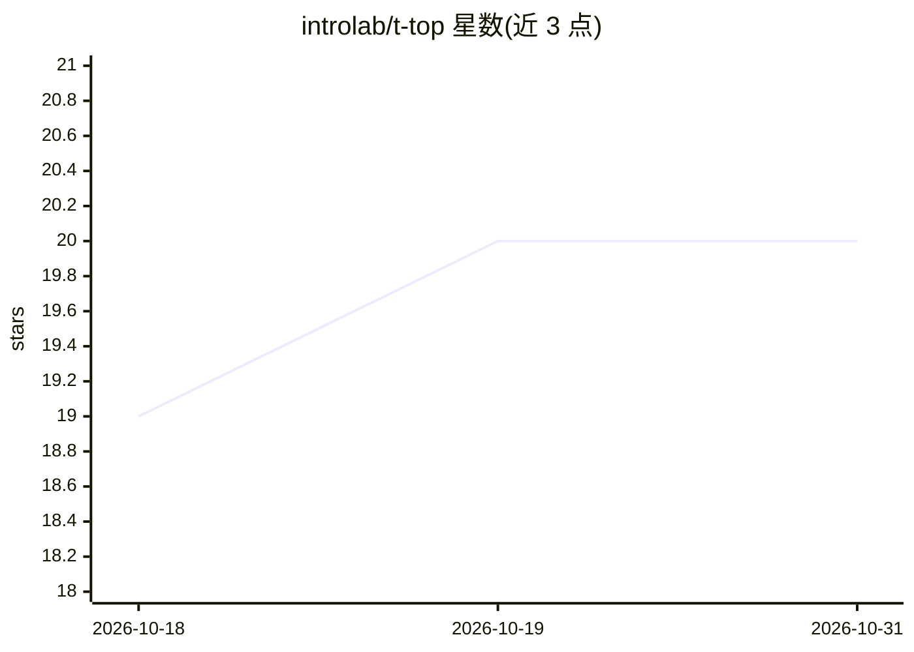

# introlab/t-top

⭐ 20 · Python · NOASSERTION · 推送 2026-10-26 · [GitHub](https://github.com/introlab/t-top) · 组织维护

**开源桌面社交陪护机器人平台：音频视觉感知与人机交互**

加拿大 IntRoLab（舍布鲁克大学）开发的开源桌面机器人（HRI/SAR 实验平台）：搭载 16 麦克风阵列、Intel RealSense D435i RGB-D 相机、广角相机等传感器，基于 NVIDIA Jetson AGX Xavier 计算模块运行深度学习感知（SLAM、目标检测、人脸识别、语音转文本、声源定位等）与行为模块（对话、情绪、遥现、跟随等）。仓库提供 SolidWorks/DXF/STL CAD 文件、KiCad PCB 文件、MCU 固件与 ROS 包，需自行制造组装硬件并编译配置，发表多篇 HRI/IROS 论文。

## 筛选速览

| 维度 | 判定 | 备注 |
|---|---|---|
| AI 角色 | `ai-native` | 本体是模型或模型工具 |
| 许可风险 | `none` | NOASSERTION |
| 部署形态 | `None` |  |
| 模型依赖 | — | README 未给出锁定关系 |
| 硬件要求 | — | 无带数字的原话,不猜 |
| 安装摩擦 | `low` | 无编译、无系统依赖或容器化 |
| 成熟度 | — | 结构信号不足 |

## 能力要点

- 16 麦克风阵列 + RGB-D 相机 + 广角相机的多模态传感
- 板载深度学习感知：SLAM、人脸识别、语音转文本、声源定位、VAD 等
- 开源硬件设计：SolidWorks CAD、KiCad PCB、DXF/STL 可加工文件
- 提供 ROS 包、Teensy MCU 固件与 10 种交互行为模块

## 适用场景

- 作为人机交互（HRI）与社会陪护机器人（SAR）研究实验平台
- 自行 3D 打印/加工并组装一台桌面社交机器人
- 开展面向老年人等人群的交互实验与评估

## 场景标签

`科研工具` · 领域:学习与行业

## 证据(README 行号)

> L3: T-Top is a tabletop robot designed with advanced audio and vision sensors, deep learning perceptual processing and
> L51: |Perceptions||SLAM, object detection, person pose estimation, face recognition, sound classification, speaker ident

## 星数曲线

2026-10-18 19 → 2026-10-31 20（+1）

---
*卡片 v1 · prompt 1.4 · 生成 2026-10-28 · 置信度 high · 依据 README sha `b4cc91e00b9a` · [字段定义](../../DATASET.md)*
