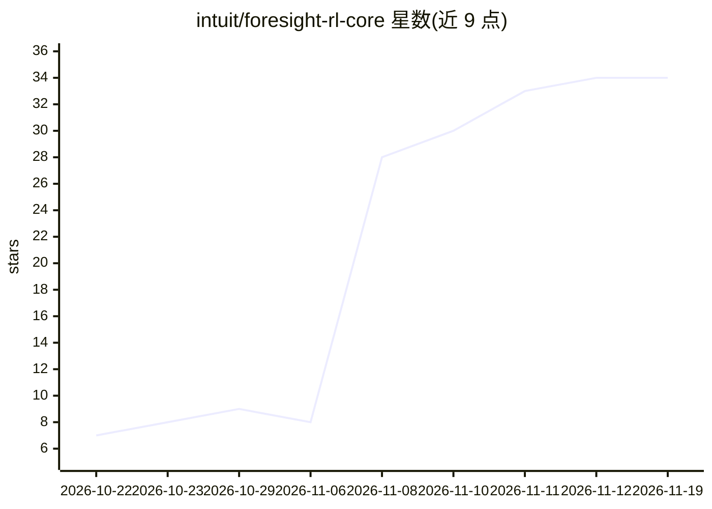

# intuit/foresight-rl-core

⭐ 34 · Python · Apache-2.0 · 推送 2026-10-18 · [GitHub](https://github.com/intuit/foresight-rl-core) · 组织维护

**给开发者的配置驱动 LLM 强化学习微调训练库**

以单个 YAML 配置驱动语言模型微调的 Python 库：支持 GRPO、DPO、SFT 等方法，可在本地 GPU、SageMaker（含 Serverless）或 HyperPod EKS 等执行后端上运行训练任务，并提供 CLI 与 Python API。附带评测（benchmark 套件生成排行榜）、优化器（质量+成本评估，LLM-as-judge）与基于 Gatling 的 vllm serve 负载测试。通过容器 recipe（qwen3/qwen3_5）解析镜像与依赖，可通过注册方法/后端/任务扩展。由 Intuit 团队维护，Apache 2.0 许可。

## 筛选速览

| 维度 | 判定 | 备注 |
|---|---|---|
| AI 角色 | `ai-ecosystem` | LLM/agent 周边工具 |
| 许可风险 | `permissive` | Apache-2.0 |
| 部署形态 | `library` | 以包/库形式分发 |
| 模型依赖 | local-ok | 支持本地模型 |
| 硬件要求 | — | 无带数字的原话,不猜 |
| 安装摩擦 | `medium` | 含编译或系统依赖之一 |
| 成熟度 | — | 结构信号不足 |

## 能力要点

- 单个 YAML 配置跨本地 GPU / SageMaker / HyperPod 后端训练
- 支持 GRPO、DPO、SFT 等 RL 微调方法，基于 TRL 可扩展
- 内置评测排行榜、质量+成本优化器与 Gatling 负载测试
- 容器 recipe 机制自动解析 DLC 镜像、框架版本与 pip 依赖

## 适用场景

- 在本地 GPU 或 AWS 上用一份配置完成 RL 微调训练
- 对候选模型做 benchmark 评测并生成带置信区间的排行榜
- 对 vllm serve 服务做 TPS 扫描负载测试
- 跨候选 LLM 做生成质量与成本评估选型

## 场景标签

`微调` `强化学习` `模型评测` · 领域:评测与运维

## 证据(README 行号)

> L6: A modular library for fine-tuning language models using reinforcement learning methods (GRPO, DPO) across multiple e
> L72: All training parameters are defined in YAML config files. See `examples/configs/` for templates:
> L179: - **New method**: Subclass `TrlMethodHandler` in `foresightrlcore/methods/<name>.py`, add method-specific validati

## 星数曲线

2026-10-22 7 → 2026-11-19 34（+27）

---
*卡片 v1 · prompt 1.4 · 生成 2026-11-18 · 置信度 high · 依据 README sha `91a1aeb497a0` · [字段定义](../../DATASET.md)*
