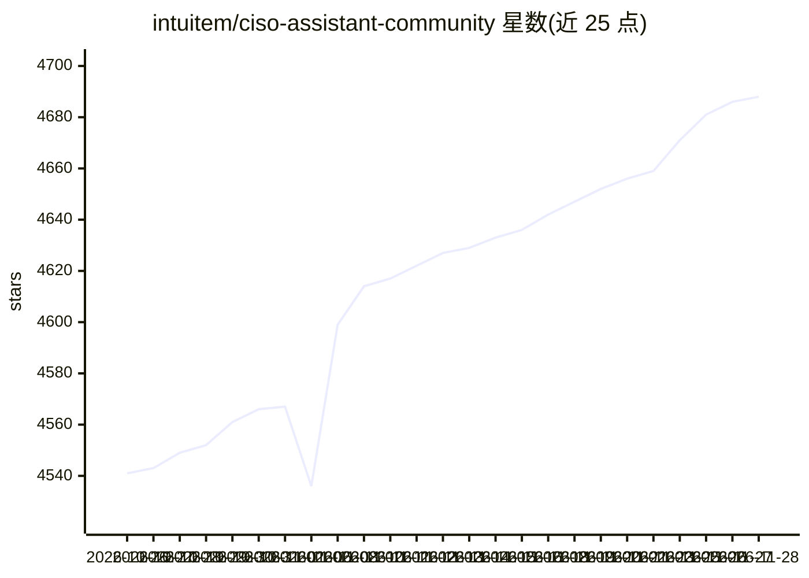

# intuitem/ciso-assistant-community

⭐ 4,688 · Python · NOASSERTION · 推送 2026-11-27 · [GitHub](https://github.com/intuitem/ciso-assistant-community) · [官网](https://intuitem.com) · 组织维护

**给安全团队的一站式 GRC 平台：风险管理、合规审计与报告**

面向网络安全与 GRC（治理、风险、合规）的管理平台，功能覆盖合规与框架管理、风险评估与登记、第三方风险管理、整改跟踪、报告分析、隐私处理（GDPR）等，内置 200+ 全球合规框架及自动控制映射（ISO 27001、NIST CSF、DORA、PCI DSS 等）。采用 API-first 设计，提供 REST API、CLI、Kafka、Webhook 等集成通道，并通过 docker-compose 脚本以预构建镜像部署，另有云托管试用版。

## 筛选速览

| 维度 | 判定 | 备注 |
|---|---|---|
| AI 角色 | `ai-enhanced` | 去掉 AI 部分产品仍成立 |
| 许可风险 | `none` | NOASSERTION |
| 部署形态 | `self-host` | docker 或自建部署 |
| 模型依赖 | — | README 未给出锁定关系 |
| 硬件要求 | — | 无带数字的原话,不猜 |
| 安装摩擦 | `low` | 无编译、无系统依赖或容器化 |
| 成熟度 | — | 结构信号不足 |

## 能力要点

- 内置 200+ 合规框架与自动控制映射，支持自定义框架
- REST API、CLI、Kafka、Webhook 等多种自动化集成通道
- 风险量化、EBIOS RM 模块、威胁建模与整改跟踪工作流
- RBAC、SSO（SAML/OIDC）、MFA、审计日志，支持 Kubernetes 部署与 28 种语言

## 适用场景

- 统一管理 ISO 27001、NIST CSF 等多个框架的合规评估
- 执行风险评估、风险登记与整改行动计划跟踪
- 对第三方供应商做风险与合同管理
- 生成审计报告与安全态势仪表盘

## 场景标签

`网络安全` · 领域:学习与行业

## 证据(README 行号)

> L25: CISO Assistant offers a fresh perspective on Cybersecurity Management and **GRC** (Governance, Risk, and Compliance
> L159: - MCP support
> L160: - AI assistant with RAG

## 星数曲线

2026-10-26 4,541 → 2026-11-28 4,688（+147）

---
*卡片 v1 · prompt 1.4 · 生成 2026-11-28 · 置信度 mid · 依据 README sha `11b262436a24` · [字段定义](../../DATASET.md)*
