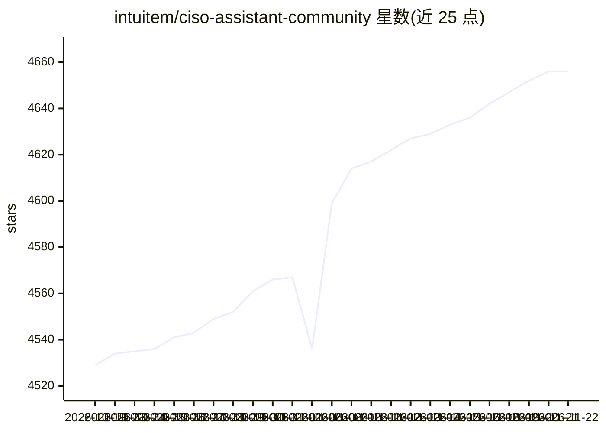

# intuitem/ciso-assistant-community

⭐ 4,656 · Python · NOASSERTION · 推送 2026-11-21 · [GitHub](https://github.com/intuitem/ciso-assistant-community) · [官网](https://intuitem.com) · 组织维护

**面向安全与合规团队的一站式 GRC 管理平台**

CISO Assistant 是一个网络安全治理、风险与合规（GRC）平台，覆盖风险管理、应用安全、合规审计、第三方风险、业务影响分析、隐私与报告等模块。内置 200+ 全球合规框架（ISO 27001、NIST CSF、SOC 2、DORA、GDPR 等）并支持自动控制映射与自定义框架；采用 API-first 设计，提供 REST API、CLI、Kafka 集成、webhook 及 RBAC/SSO/MFA 等企业访问控制。由 Intuitem 公司维护，提供云端试用与自托管部署。

## 筛选速览

| 维度 | 判定 | 备注 |
|---|---|---|
| AI 角色 | `ai-enhanced` | 去掉 AI 部分产品仍成立 |
| 许可风险 | `none` | NOASSERTION |
| 部署形态 | `self-host` | docker 或自建部署 |
| 模型依赖 | — | README 未给出锁定关系 |
| 硬件要求 | — | 无带数字的原话,不猜 |
| 安装摩擦 | `low` | 无编译、无系统依赖或容器化 |
| 成熟度 | — | 结构信号不足 |

## 能力要点

- 内置 200+ 合规框架并支持自动控制映射
- 风险管理与整改跟踪工作流内置
- REST API、CLI、Kafka、webhook 等多种集成通道
- 支持 Helm/Kubernetes 部署，提供 28 种语言界面

## 适用场景

- 统一管理 ISO 27001、NIST CSF 等多框架合规评估
- 开展风险评估、风险登记册与整改行动计划跟踪
- 对第三方供应商进行风险管理并维护 DORA 信息登记册
- 通过 REST API 或 CLI 自动化合规数据导入导出

## 场景标签

`网络安全` · 领域:学习与行业

## 证据(README 行号)

> L25: CISO Assistant offers a fresh perspective on Cybersecurity Management and **GRC** (Governance, Risk, and Compliance
> L160: - AI assistant with RAG
> L189: CISO Assistant is developed and maintained by Intuitem, a company specialized in Cybersecurity, Cloud, and Data/AI

## 星数曲线

2026-10-19 4,529 → 2026-11-22 4,656（+127）

---
*卡片 v1 · prompt 1.4 · 生成 2026-11-22 · 置信度 mid · 依据 README sha `5650fe487dc5` · [字段定义](../../DATASET.md)*
