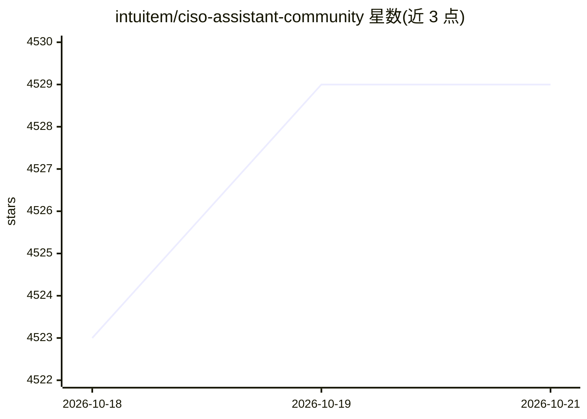

# intuitem/ciso-assistant-community

⭐ — · [GitHub]() · 组织维护

**网络安全 GRC 一体化平台：风险管理、合规审计与报告**

面向 CISO 与安全团队的治理、风险与合规（GRC）平台：内置 220+ 合规框架（ISO 27001、NIST CSF、SOC 2、DORA、GDPR、EU AI Act 等）并支持自动控制映射；覆盖风险评估（含 EBIOS RM）、威胁建模、第三方风险管理、漏洞管理、补救追踪、事件管理与报告生成。提供 REST API、CLI、Kafka、MCP 集成，其中 AI 部分为带 RAG 的 AI 助手并可配置本地 AI 引擎。通过 Docker Compose 脚本或 Kubernetes Helm 部署，由 Intuitem 公司维护，另有 SaaS 云版本试用。

## 筛选速览

| 维度 | 判定 | 备注 |
|---|---|---|
| AI 角色 | `ai-enhanced` | 去掉 AI 部分产品仍成立 |
| 许可风险 | `none` | — |
| 部署形态 | `self-host` | docker 或自建部署 |
| 模型依赖 | — | README 未给出锁定关系 |
| 硬件要求 | — | 无带数字的原话,不猜 |
| 安装摩擦 | `low` | 无编译、无系统依赖或容器化 |
| 成熟度 | — | 结构信号不足 |

## 能力要点

- 内置 220+ 合规框架并支持自动控制映射与自定义框架语法
- 风险评估（EBIOS RM）、威胁建模、补救追踪与报告生成工作流
- REST API、CLI、Kafka、MCP、Jira/ServiceNow 等自动化集成
- 带 RAG 的 AI 助手，支持配置本地 AI 引擎

## 适用场景

- 对照多个合规框架统一管理评估与审计证据
- 开展 EBIOS RM 风险评估并跟踪补救行动计划
- 管理第三方风险与 DORA 信息登记等监管要求

## 场景标签

`网络安全` · 领域:学习与行业

## 证据(README 行号)

> L25: CISO Assistant offers a fresh perspective on Cybersecurity Management and **GRC** (Governance, Risk, and Compliance
> L160: - AI assistant with RAG
> L218: ## Setting up the local AI engine

## 星数曲线

2026-10-18 4,523 → 2026-10-21 4,529（+6）

---
*卡片 v1 · prompt 1.4 · 生成 2026-10-21 · 置信度 mid · 依据 README sha `f99a40ba639f` · [字段定义](../../DATASET.md)*
