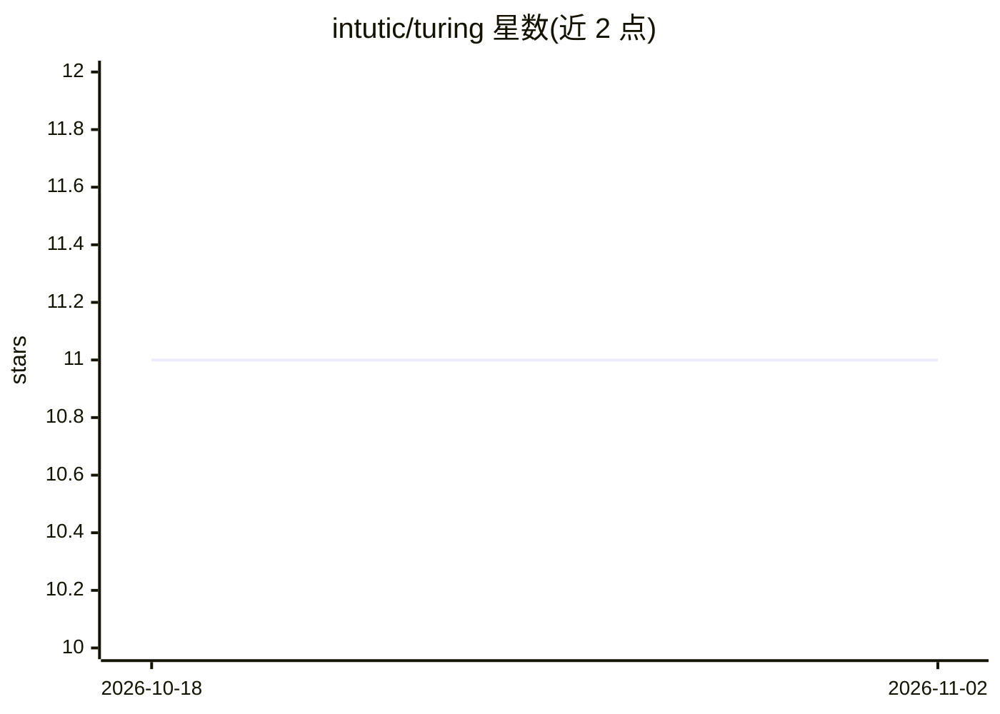

# intutic/turing

⭐ 11 · Python · NOASSERTION · 推送 2026-10-29 · [GitHub](https://github.com/intutic/turing) · [官网](https://intutic.github.io/turing/) · 组织维护

**在单张 24GB GPU 上运行 70B+ 模型的 LLM 推理服务运行时**

面向开发者的 LLM serving 运行时：从 Hugging Face Hub 流式加载或读取本地 GGUF 权重，提供 OpenAI/Anthropic/Ollama 三套兼容 API 网关，支持分布式多 GPU 张量/流水线并行、Turing DSL 多步工作流编排，以及零 Python 依赖的 C++20 独立可执行文件。内存侧采用 SVD INT8 KV 缓存压缩（宣称 32K 上下文 10GB 降至 2.5GB）与子空间激活剪枝。硬件支持覆盖 NVIDIA/AMD/Intel/Apple 及 Vulkan/CPU 后端。许可证为 BSL 1.1，非 OSI 开源协议；通过 pip 安装。

## 筛选速览

| 维度 | 判定 | 备注 |
|---|---|---|
| AI 角色 | `ai-ecosystem` | LLM/agent 周边工具 |
| 许可风险 | `none` | NOASSERTION |
| 部署形态 | `library` | 以包/库形式分发 |
| 模型依赖 | — | README 未给出锁定关系 |
| 硬件要求 | `gpu-8g` | |
| 安装摩擦 | `high` | 编译与系统依赖俱全 |
| 成熟度 | — | 结构信号不足 |

## 能力要点

- OpenAI + Anthropic + Ollama 三兼容 API 网关
- Hugging Face Hub 流式加载与本地 GGUF 直接读取
- 多 GPU 张量并行/流水线并行与 torchrun 集群启动
- 零 Python 依赖的 C++20 独立可执行文件（CMake 构建）

## 适用场景

- 在单张消费级 GPU 上部署 70B 级开源模型并暴露 OpenAI 兼容接口
- 让 Open WebUI、Continue.dev、Cursor 等客户端接入本地推理服务
- 在多 GPU 节点上以张量/流水线并行服务大模型

## 场景标签

`推理引擎` `模型量化` · 领域:训练与推理

## 证据(README 行号)

> L30: ### 3. Launch Triple API Gateway (OpenAI, Anthropic & Ollama Compatible)
> L33: turing serve --model meta-llama/Llama-3.3-70B-Instruct --port 8000
> L58: ### 6. Distributed Multi-GPU & Pipeline Parallel Serving

## 星数曲线

2026-10-18 11 → 2026-11-02 11（+0）

---
*卡片 v1 · prompt 1.4 · 生成 2026-11-02 · 置信度 high · 依据 README sha `503f55951e26` · [字段定义](../../DATASET.md)*
