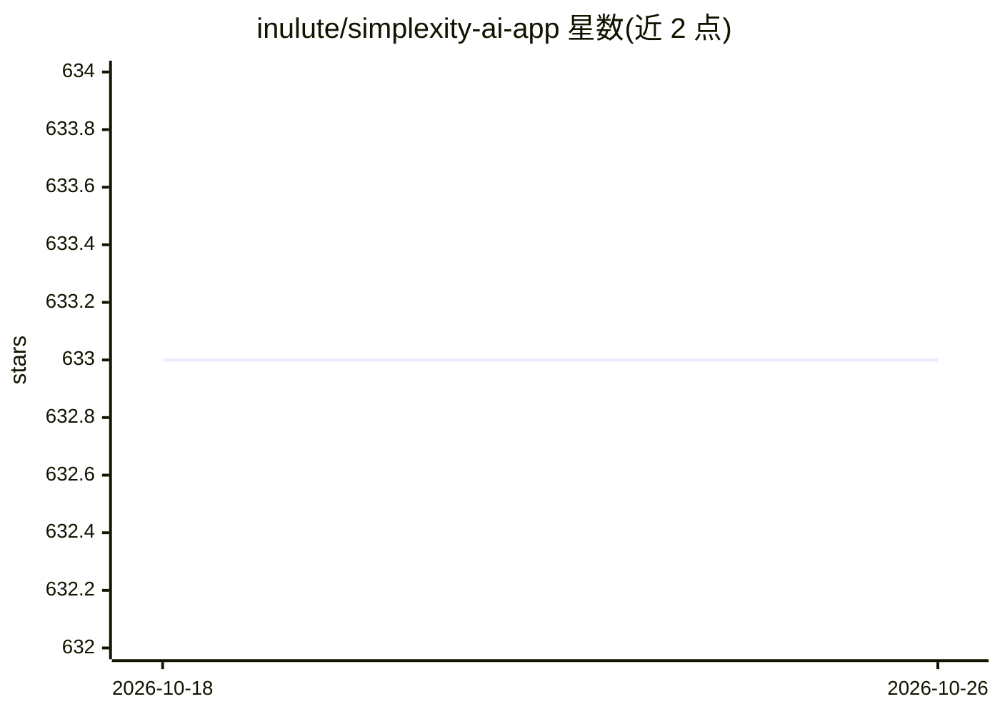

# inulute/simplexity-ai-app

⭐ 633 · JavaScript · GPL-3.0 · 推送 2026-08-16 · [GitHub](https://github.com/inulute/simplexity-ai-app) · 个人维护

**加载 Perplexity 网页服务的非官方 Electron 桌面客户端**

基于 Electron 的社区开发桌面应用，在嵌入式 BrowserView 中加载 Perplexity 的公开网站，所有 AI 搜索功能由 Perplexity 网页服务提供。应用本身添加桌面便利功能：系统托盘与后台常驻、开机自启、全局快捷键（任意位置选中文本即时搜索）、自定义前缀搜索模板、页内查找（Ctrl+F）、窗口状态与会话记忆、缩放控制。声明不收集用户数据、设置本地存储；需联网，无法离线搜索。提供 Windows/macOS/Linux 安装包与源码构建两种途径。

## 筛选速览

| 维度 | 判定 | 备注 |
|---|---|---|
| AI 角色 | `ai-ecosystem` | LLM/agent 周边工具 |
| 许可风险 | `viral` | GPL-3.0 |
| 部署形态 | `desktop` | 安装包/桌面程序 |
| 模型依赖 | — | README 未给出锁定关系 |
| 硬件要求 | — | 无带数字的原话,不猜 |
| 安装摩擦 | `low` | 无编译、无系统依赖或容器化 |
| 成熟度 | — | 结构信号不足 |

## 能力要点

- Electron 桌面封装 Perplexity 网页服务，声明非官方、与其无隶属关系
- 全局快捷键：任意应用中选中文本即时发起 AI 搜索
- 自定义前缀搜索模板（Explain/Summarize/Translate 等模式）
- 系统托盘、开机自启、窗口状态与会话持久化

## 适用场景

- 在桌面端常驻使用 Perplexity 网页服务并保持会话
- 选中文本后用全局快捷键直接发起 AI 搜索
- 用前缀模板快速执行解释/总结/翻译类重复查询

## 场景标签

`聊天机器人` · 领域:对话与助手

## 证据(README 行号)

> L24: > This application simply loads P AI's public website (P.ai) in a native desktop container with added convenience f
> L340:  A: SimplexityAI is a desktop application that loads P AI's public website (P.ai) in an embedded browser view. All

## 星数曲线

2026-10-18 633 → 2026-10-26 633（+0）

---
*卡片 v1 · prompt 1.4 · 生成 2026-10-21 · 置信度 mid · 依据 README sha `702a99a44895` · [字段定义](../../DATASET.md)*
