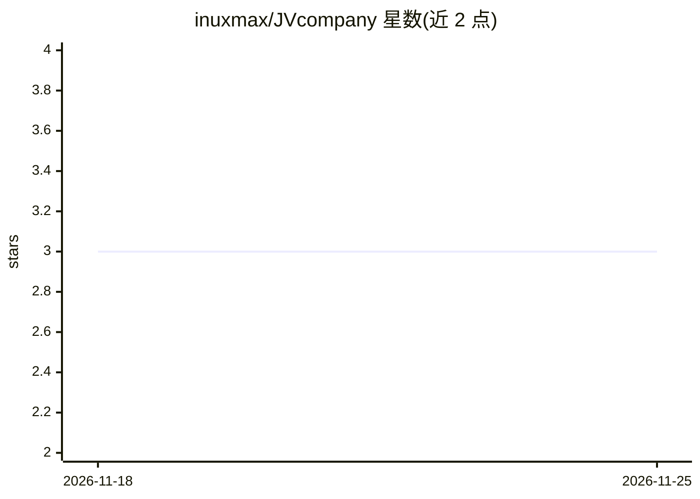

# inuxmax/JVcompany

⭐ 3 · TypeScript · MIT · 推送 2026-10-31 · [GitHub](https://github.com/inuxmax/JVcompany) · [官网](https://inuxmax.github.io/JVcompany/) · 个人维护 · 中文 README

**自托管多 Agent 编排平台：10 个 AI 部门在 3D 办公室协作交付软件任务**

以 Next.js + three.js + MongoDB 实现的自托管多 Agent 编排平台，将软件公司建模为 CEO、PM、开发、QA 等 10 个部门 Agent，每个 Agent 有专属系统提示、权限与模型；请求经 CEO 拆解为带依赖的 hand-off 链自动流转。接入订阅 CLI（Claude Code、Codex、Gemini CLI 等）、各类 API key 与 Ollama/LM Studio 本地模型；支持权限审批、预算上限、速率限制重试、密钥加密与 Docker/源码安装，浏览器或 Electron 桌面端运行。

## 筛选速览

| 维度 | 判定 | 备注 |
|---|---|---|
| AI 角色 | `ai-ecosystem` | LLM/agent 周边工具 |
| 许可风险 | `permissive` | MIT |
| 部署形态 | `self-host` | docker 或自建部署 |
| 模型依赖 | local-ok | 支持本地模型 |
| 硬件要求 | — | 无带数字的原话,不猜 |
| 安装摩擦 | `low` | 无编译、无系统依赖或容器化 |
| 成熟度 | — | 结构信号不足 |

## 能力要点

- 10 个预置部门 Agent，可增删改提示与权限，经 hand-off 链自动派发任务
- 接入订阅 CLI、API key（Anthropic/OpenAI/Gemini/DeepSeek 等）与 Ollama/LM Studio 本地模型
- 四级权限 + 审批流；速率限制感知自动等待重试并可切换 fallback 连接
- three.js 实时 3D 办公楼，5 层并行 5 个项目，Agent 动作映射真实任务状态

## 适用场景

- 提交一个需求，让多 Agent 部门链完成设计、开发、测试与报告
- 用已有 Claude Code/Codex 订阅或本地模型编排团队工作流
- 按部门/项目设定 token 预算并在超限自动暂停

## 场景标签

`多智能体` `编码 Agent` `Agent 框架` · 领域:Agent 开发

## 证据(README 行号)

> L20: **JVCompany** is an open-source, self-hosted **multi-agent orchestration platform** that models a real software com
> L24: It plugs into the AI tools you already pay for: **Claude Code, OpenAI Codex, Gemini CLI, Cursor Agent, GitHub Copil
> L26: Runs in the **browser** or as a **desktop app** (Windows, macOS, Linux). Data stays on your machine in **MongoDB**.

## 星数曲线

2026-11-18 3 → 2026-11-25 3（+0）

---
*卡片 v1 · prompt 1.4 · 生成 2026-11-21 · 置信度 low · 依据 README sha `7967504f2695` · [字段定义](../../DATASET.md)*
