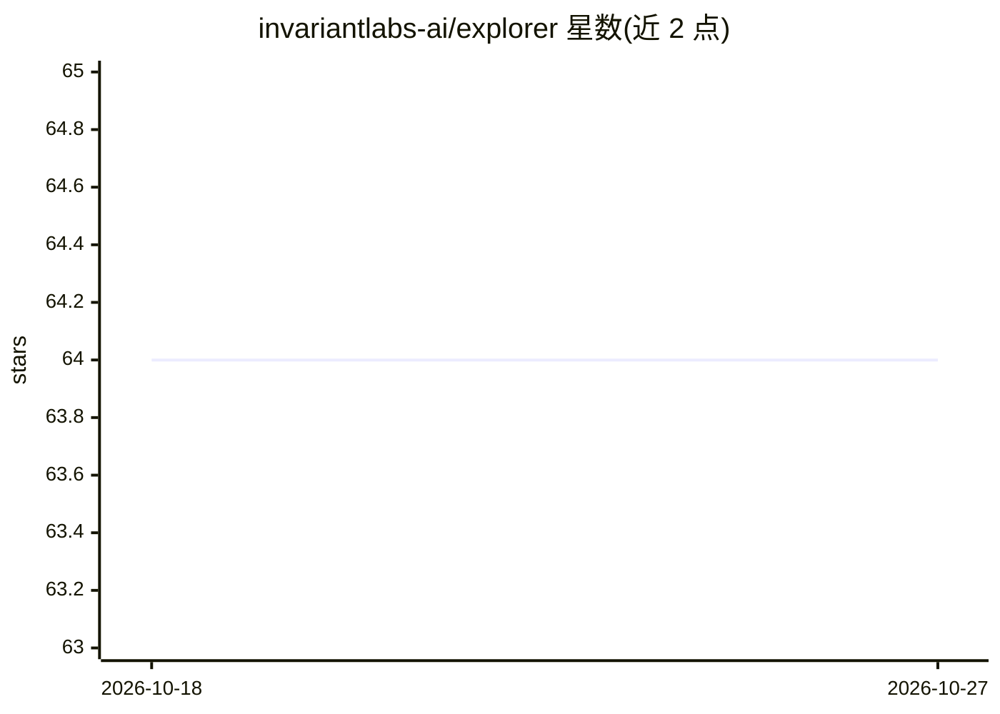

# invariantlabs-ai/explorer

⭐ 64 · TypeScript · Apache-2.0 · 推送 2026-01-12 · [GitHub](https://github.com/invariantlabs-ai/explorer) · [官网](https://invariantlabs.ai/blog/explorer) · 组织维护

**可视化浏览与测试 AI Agent 执行轨迹的自托管工具**

Invariant Labs 开源的 Agent trace 检查工具，用于对 AI agent 的执行轨迹做测试、检查与分析，提供浏览器界面在 localhost 访问。通过 pip 安装 invariant-ai 包后运行 invariant explorer 命令，经由 Docker Compose 拉取并启动应用；数据存储在本地 ./data 目录。开发流程由 ./run.sh 脚本管理（启动/测试/依赖编译/日志）。注意：托管版已于 2026 年 1 月关停，仅剩自托管使用方式。

## 筛选速览

| 维度 | 判定 | 备注 |
|---|---|---|
| AI 角色 | `ai-ecosystem` | LLM/agent 周边工具 |
| 许可风险 | `permissive` | Apache-2.0 |
| 部署形态 | `self-host` | docker 或自建部署 |
| 模型依赖 | — | README 未给出锁定关系 |
| 硬件要求 | — | 无带数字的原话,不猜 |
| 安装摩擦 | `low` | 无编译、无系统依赖或容器化 |
| 成熟度 | — | 结构信号不足 |

## 能力要点

- 在浏览器中可视化探索 agent traces
- pip 包 + Docker Compose 本地部署，数据存于 ./data
- ./run.sh 脚本管理启动、测试与依赖编译

## 适用场景

- 调试 AI agent 的执行轨迹
- 对 agent 行为做检查与测试分析
- 团队自托管部署 agent trace 检查工具

## 场景标签

`LLM 可观测性` `模型评测` · 领域:评测与运维

## 证据(README 行号)

> L3: > **Note:** The hosted version of Invariant Explorer has been shut down in January 2026. If you're interested in Inv
> L5: A tool for visualizing and exploring agent traces.

## 星数曲线

2026-10-18 64 → 2026-10-27 64（+0）

---
*卡片 v1 · prompt 1.4 · 生成 2026-10-24 · 置信度 high · 依据 README sha `f27ae3fd3842` · [字段定义](../../DATASET.md)*
