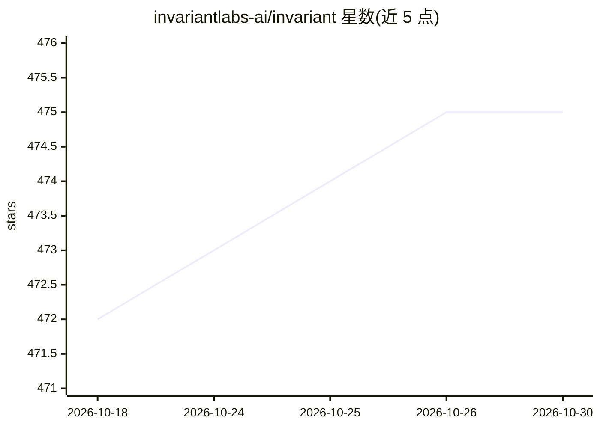

# invariantlabs-ai/invariant

⭐ 475 · Python · Apache-2.0 · 推送 2026-01-12 · [GitHub](https://github.com/invariantlabs-ai/invariant) · [官网](https://invariantlabs.ai) · 组织维护

**为 LLM/MCP 智能体应用提供规则式安全护栏层**

Invariant Guardrails 是部署在应用与 MCP 服务器或 LLM 提供方之间的护栏层，以 Python 风格的匹配规则识别并拦截恶意智能体行为（如工具调用间的外发邮件），支持对 LLM 与 MCP 请求在前后阶段自动检查与拦截。集成方式有两种：通过 Gateway 代理透明接入，或使用 invariant-ai 包在代码中加载规则（Policy）并对 agent trace 本地评估。规则可扫描消息内容、检测工具调用流，附带标准操作库。由 Invariant Labs 开源维护。

## 筛选速览

| 维度 | 判定 | 备注 |
|---|---|---|
| AI 角色 | `ai-ecosystem` | LLM/agent 周边工具 |
| 许可风险 | `permissive` | Apache-2.0 |
| 部署形态 | `None` |  |
| 模型依赖 | — | README 未给出锁定关系 |
| 硬件要求 | — | 无带数字的原话,不猜 |
| 安装摩擦 | `low` | 无编译、无系统依赖或容器化 |
| 成熟度 | — | 结构信号不足 |

## 能力要点

- 部署在应用与 MCP/LLM 提供方之间的代理式护栏层，无需侵入式代码改动
- Python 风格规则语言，支持工具调用流检测与消息内容扫描
- 两种接入方式：Gateway 代理或 invariant-ai 包本地评估 trace
- 请求前后自动评估规则并可拦截违规请求

## 适用场景

- 拦截智能体的恶意或违规工具调用行为
- 对 LLM/MCP 流量按自定义策略持续监控
- 在代码中本地评估 agent trace 是否违反规则

## 场景标签

`网络安全` · 领域:学习与行业

## 证据(README 行号)

> L8: Invariant Guardrails is a comprehensive rule-based guardrailing layer for LLM or MCP-powered AI applications. It is 
> L19: Guardrails integrates transparently as MCP or LLM proxy, checking and intercepting tool calls automatically based o

## 星数曲线

2026-10-18 472 → 2026-10-30 475（+3）

---
*卡片 v1 · prompt 1.4 · 生成 2026-10-21 · 置信度 high · 依据 README sha `e2d249ad4ada` · [字段定义](../../DATASET.md)*
