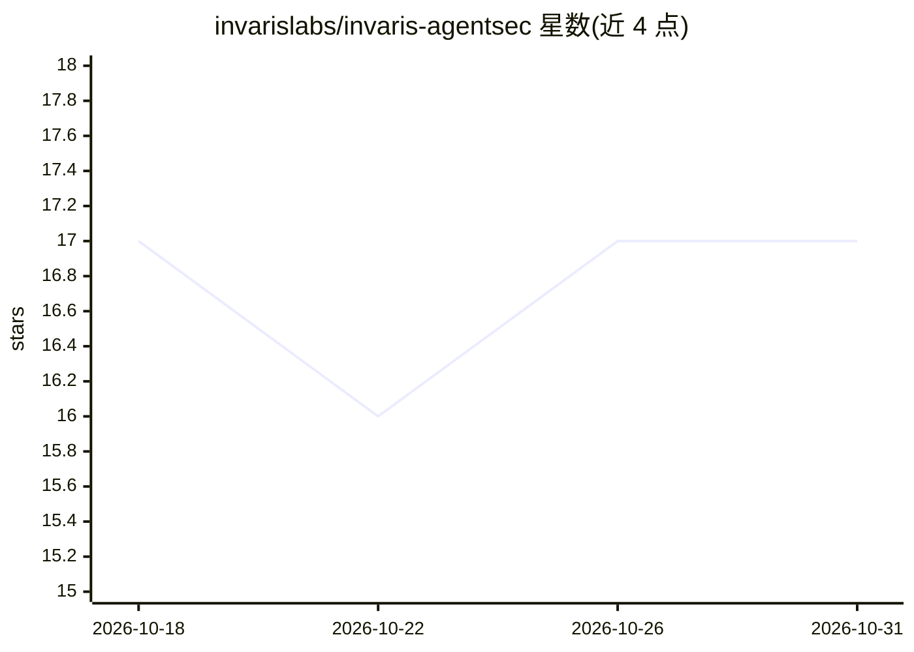

# invarislabs/invaris-agentsec

⭐ 17 · Python · Apache-2.0 · 推送 2026-10-30 · [GitHub](https://github.com/invarislabs/invaris-agentsec) · [官网](https://pypi.org/project/invaris-agentsec/) · 组织维护

**面向 AI agent 的对抗性安全测试框架，覆盖提示注入、工具滥用与 MCP 扫描**

Invaris AgentSec 是一个开源的 AI agent 安全与可靠性测试框架，供开发者在生产前测试包含 LLM、检索管道、记忆、MCP 服务器与外部工具的完整 agent 工作流。它运行有状态的对抗场景（直接/间接提示注入、未授权工具调用、记忆投毒、敏感数据泄露、无限循环、危险调用组合等 13 类默认检查），观测完整执行轨迹并核验安全策略，发现项映射到 OWASP Agentic Top 10（ASI01-ASI10）。以 pip 安装的 CLI 提供，支持 CI 集成、GitHub Action 回归对比、报告生成（json/html/markdown/sarif）、本地只读 dashboard、MCP 服务器扫描（只列举不调用）与 LangChain/LangGraph 进程内适配。默认本地运行，不发送私有轨迹。

## 筛选速览

| 维度 | 判定 | 备注 |
|---|---|---|
| AI 角色 | `ai-ecosystem` | LLM/agent 周边工具 |
| 许可风险 | `permissive` | Apache-2.0 |
| 部署形态 | `library` | 以包/库形式分发 |
| 模型依赖 | — | README 未给出锁定关系 |
| 硬件要求 | — | 无带数字的原话,不猜 |
| 安装摩擦 | `low` | 无编译、无系统依赖或容器化 |
| 成熟度 | — | 结构信号不足 |

## 能力要点

- 13 类默认对抗场景 + 可选链上攻击包，发现映射 OWASP Agentic Top 10
- 场景结果四态判定（findings/passed/inconclusive/error），inconclusive 不计为通过
- agentsec replay 按记录种子复现发现，agentsec compare 检出行为回归
- MCP 服务器扫描（投毒描述、同形字工具名冒充、只读/破坏性标注欺骗等）
- 本地只读 dashboard 与 SARIF 报告输出（GitHub Code Scanning）

## 适用场景

- 在 CI 中对 agent 做安全回归测试，PR 上自动对比新增/修复的发现
- 上线前测试 agent 是否会被间接提示注入或投毒的工具输出操纵
- 扫描 MCP 服务器的工具定义是否被投毒或冒充
- 模型或提示更新后比较 agent 行为差异

## 场景标签

`网络安全` `模型评测` · 领域:评测与运维

## 证据(README 行号)

> L5: Invaris AgentSec is an open-source testing framework for finding unsafe, unauthorized, and unreliable agent behaviou
> L21: Unit tests alone cannot adequately exercise these behaviours. AgentSec runs stateful adversarial scenarios, observe
> L60: Findings are mapped to the OWASP Top 10 for Agentic Applications (ASI01 to ASI10).

## 星数曲线

2026-10-18 17 → 2026-10-31 17（+0）

---
*卡片 v1 · prompt 1.4 · 生成 2026-10-30 · 置信度 high · 依据 README sha `2fc529c33cbb` · [字段定义](../../DATASET.md)*
