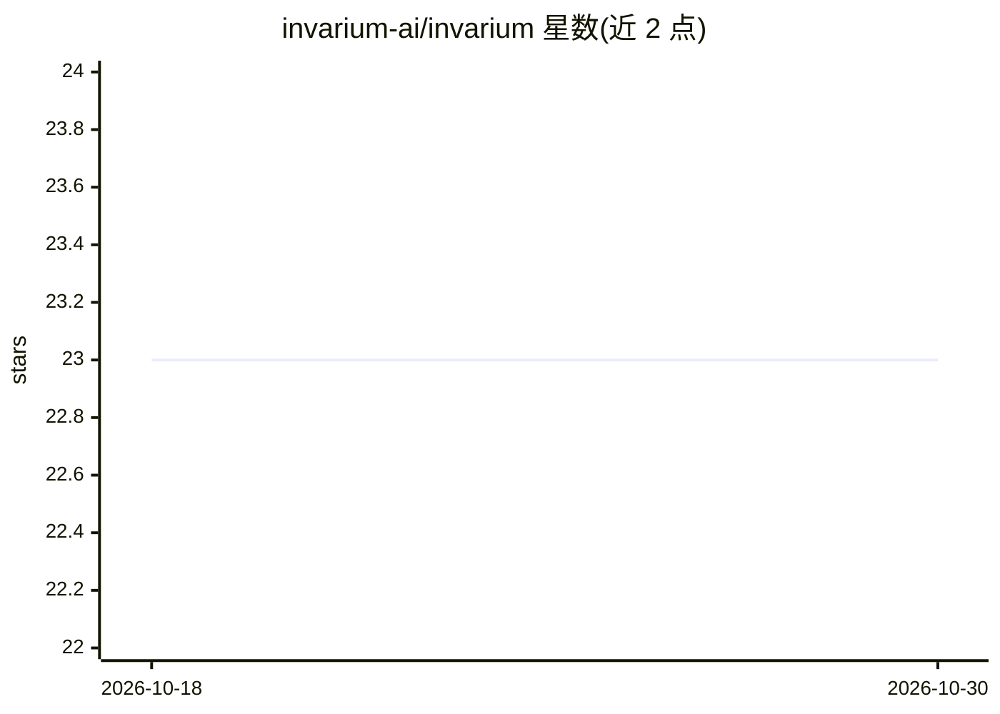

# invarium-ai/invarium

⭐ 23 · Python · MIT · 推送 2026-07-14 · [GitHub](https://github.com/invarium-ai/invarium) · [官网](https://invarium.dev/?utm_source=github) · 组织维护

**AI agent 行为测试框架：断言工具调用而非精确文本**

面向 AI agent 开发者的行为测试与回归检测库：以装饰器 @agent_test 编写测试，断言对象是可观察行为——调用了哪些工具、调用顺序、步数预算、成本、延迟及是否未做工作即声称成功。支持多次运行计算 flakiness_score，bless 保存基线后自动检测成功率、步数、成本等漂移。通过适配器支持 OpenAI Agents、LangGraph、CrewAI、纯 Python 可调用对象及任意 HTTP 端点，测试亦可直接经 pytest 运行，并输出 HTML/Markdown 报告与 GitHub Actions 集成。需 Python 3.10+，以 PyPI 包 invarium 及同名 CLI 提供。

## 筛选速览

| 维度 | 判定 | 备注 |
|---|---|---|
| AI 角色 | `ai-ecosystem` | LLM/agent 周边工具 |
| 许可风险 | `permissive` | MIT |
| 部署形态 | `library` | 以包/库形式分发 |
| 模型依赖 | — | README 未给出锁定关系 |
| 硬件要求 | — | 无带数字的原话,不猜 |
| 安装摩擦 | `low` | 无编译、无系统依赖或容器化 |
| 成熟度 | — | 结构信号不足 |

## 能力要点

- 行为断言：工具使用、顺序、步数/成本/延迟预算、成功声明核验
- bless 基线 + --fail-on-regression 回归检测
- 多次运行计算 flakiness_score 并标记不稳定工具路径
- 5 种适配器（Python/OpenAI Agents/LangGraph/CrewAI/HTTP），支持 pytest 直接运行

## 适用场景

- 为 LLM agent 写不依赖精确文本输出的单元测试
- CI 中检测 agent 行为与性能（步数/成本/延迟）回归
- 测试已部署的 HTTP 端点 agent 而无需本地代码

## 场景标签

`模型评测` · 领域:评测与运维

## 证据(README 行号)

> L16: Invarium brings the discipline of unit testing to AI agents. Instead of asserting
> L19: without doing the work. It then tracks that behavior over time and flags regressions
> L38: - **Framework-agnostic** — works with OpenAI Agents, LangGraph, CrewAI, plain Python

## 星数曲线

2026-10-18 23 → 2026-10-30 23（+0）

---
*卡片 v1 · prompt 1.4 · 生成 2026-10-27 · 置信度 high · 依据 README sha `b4b2ee76ae5d` · [字段定义](../../DATASET.md)*
