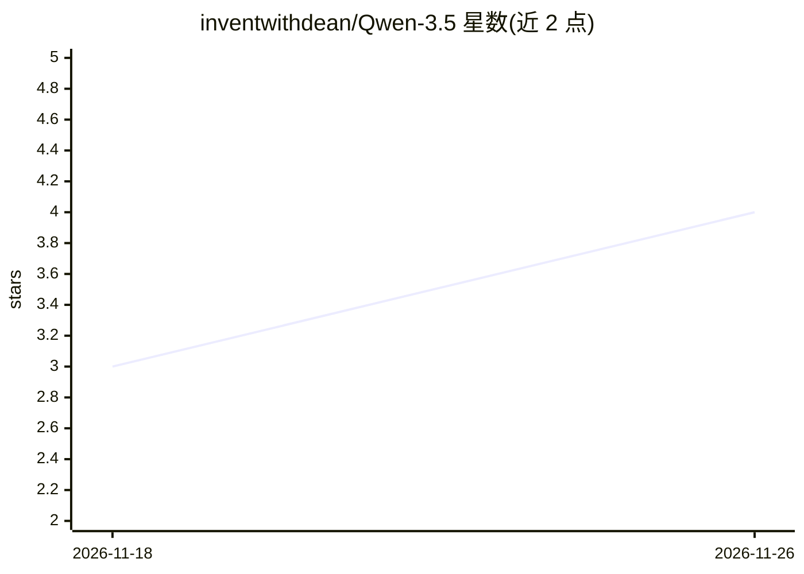

# inventwithdean/Qwen-3.5

⭐ 4 · Rust · MIT · 推送 2026-10-24 · [GitHub](https://github.com/inventwithdean/Qwen-3.5) · 个人维护

**Rust 实现的 Qwen3.5 2B 本地推理引擎，含自研 GPU 内核**

用 Rust 从零实现 Qwen3.5 2B 文本模型的本地推理引擎，基于 Burn 与 CubeCL 构建，经 wgpu 运行于 GPU。作者将逐 token 投影替换为自定义 Q8F 量化内核（8-bit、per-block-64、f32 scale），README 给出单 GPU 上解码吞吐从约 11 tok/s 到约 43 tok/s 的对比数据；基准条件为 decode-only、贪心采样、batch size 1。模型权重需从 Hugging Face 下载并离线量化生成 model.bpk 后运行。代码 MIT、权重 Apache 2.0。

## 筛选速览

| 维度 | 判定 | 备注 |
|---|---|---|
| AI 角色 | `ai-native` | 本体是模型或模型工具 |
| 许可风险 | `permissive` | MIT |
| 部署形态 | `None` |  |
| 模型依赖 | — | README 未给出锁定关系 |
| 硬件要求 | — | 无带数字的原话,不猜 |
| 安装摩擦 | `low` | 无编译、无系统依赖或容器化 |
| 成熟度 | — | 结构信号不足 |

## 能力要点

- Rust + Burn + CubeCL 实现的本地 GPU 推理（经 wgpu）
- 自定义 Q8F 量化内核，README 记录约 11→43 tok/s 的解码对比
- 8-bit per-block-64 对称量化、f32 scale，量化为一次性离线步骤
- 从 Hugging Face 下载 safetensors 与 tokenizer 生成 model.bpk

## 适用场景

- 在本地 GPU 上运行 Qwen3.5 2B 生成文本
- 学习 Burn/CubeCL 自定义内核的推理实现
- 复现 Q8F 量化内核的解码吞吐基准

## 场景标签

`推理引擎` `模型量化` · 领域:训练与推理

## 证据(README 行号)

> L1: # A Rust inference engine for Qwen 3.5 with custom CubeCL kernels
> L3: Local inference for the **Qwen3.5 2B** text model, written from scratch in Rust on top of
> L5: running on the GPU through `wgpu`.

## 星数曲线

2026-11-18 3 → 2026-11-26 4（+1）

---
*卡片 v1 · prompt 1.4 · 生成 2026-11-21 · 置信度 high · 依据 README sha `66b95b888f34` · [字段定义](../../DATASET.md)*
