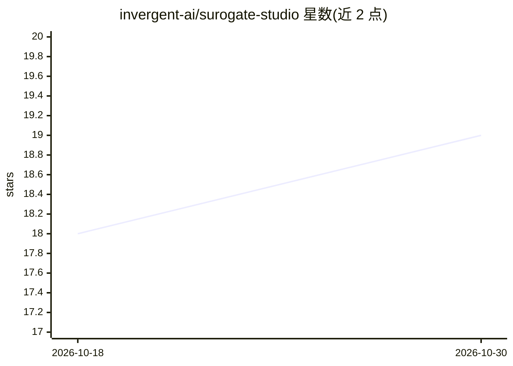

# invergent-ai/surogate-studio

⭐ 19 · Java · Apache-2.0 · 推送 2026-02-25 · [GitHub](https://github.com/invergent-ai/surogate-studio) · [官网](https://www.invergent.ai/surogate) · 组织维护

**企业级 LLMOps 平台：LLM 部署、微调、评测一体化**

面向生成式 AI 应用的企业级 LLMOps 平台，将部署、预训练/微调（LoRA/QLoRA、多精度）、评测与安全红队、Kubernetes 与多云工作负载编排整合在单一平台。机制包括 KV 感知路由、GPU 分片与分离式服务、基于 Ray 的多 GPU/多节点、Git 式模型与数据集 Hub、从模板或自定义 UI 部署应用并附 Surogate Agent。可通过 Docker、Helm 部署，也可配置为气隙运行。

## 筛选速览

| 维度 | 判定 | 备注 |
|---|---|---|
| AI 角色 | `ai-ecosystem` | LLM/agent 周边工具 |
| 许可风险 | `permissive` | Apache-2.0 |
| 部署形态 | `self-host` | docker 或自建部署 |
| 模型依赖 | — | README 未给出锁定关系 |
| 硬件要求 | — | 无带数字的原话,不猜 |
| 安装摩擦 | `low` | 无编译、无系统依赖或容器化 |
| 成熟度 | — | 结构信号不足 |

## 能力要点

- 统一部署/微调/评测/安全红队的单平台
- KV 感知路由、GPU 分片、Ray 多 GPU 多节点训练
- MMLU/ARC/GSM8k 等基准与毒性/偏见/PII 红队评测
- Kubernetes 原生扩展与 AWS/GCP/OCI/RunPod 云集成，支持气隙部署

## 适用场景

- 在企业内完成 LLM 从微调实验到生产部署的流程
- 对模型跑标准基准与安全红队评测
- 在本地或公有云 Kubernetes 集群上编排 GPU 工作负载

## 场景标签

`模型评测` `微调` `MLOps` `推理引擎` · 领域:评测与运维

## 证据(README 行号)

> L13: **Surogate Studio** is an enterprise-grade **LLMOps platform** built to accelerate the development and deployment o
> L15: It unifies **deployment**, **fine-tuning**, **evaluation**, **safeguarding**, and **optimization** into a single pl

## 星数曲线

2026-10-18 18 → 2026-10-30 19（+1）

---
*卡片 v1 · prompt 1.4 · 生成 2026-10-29 · 置信度 mid · 依据 README sha `735c0c314b84` · [字段定义](../../DATASET.md)*
