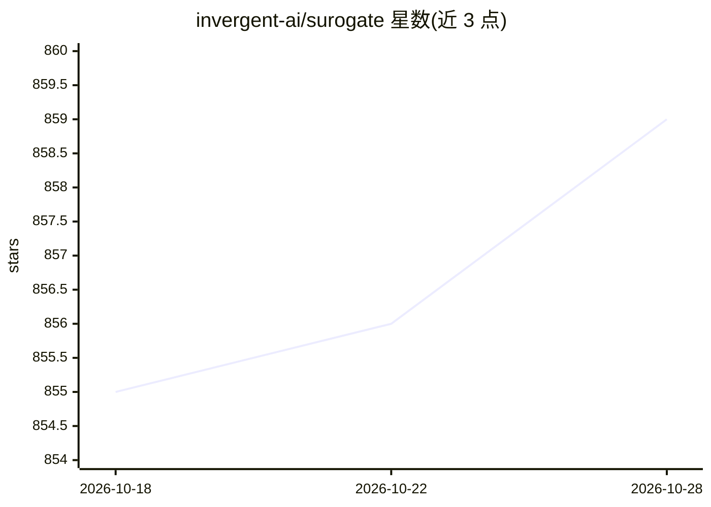

# invergent-ai/surogate

⭐ 859 · C++ · Apache-2.0 · 推送 2026-10-28 · [GitHub](https://github.com/invergent-ai/surogate) · [官网](https://surogate.ai) · 组织维护

**面向开发者的 C++/CUDA LLM 训练与推理一体化引擎**

Surogate Engine 是用原生 C++/CUDA 编写的 LLM 训练与推理工具包，支持 GGUF、NVFP4、BF16、FP4/FP8 等格式与精度。训练能力覆盖预训练、SFT 全量微调、LoRA/QLoRA、GRPO、DPO、知识蒸馏、MoE 训练与多 GPU/多节点；推理侧支持并发服务与 HTTP API。面向需要在 NVIDIA GPU（RTX 5090、H100、DGX Spark 等）上训练和服务模型的开发者和团队。README 大量篇幅为与 vLLM、llama.cpp、Unsloth 的基准对比数据。许可为 Apache 2.0。

## 筛选速览

| 维度 | 判定 | 备注 |
|---|---|---|
| AI 角色 | `ai-ecosystem` | LLM/agent 周边工具 |
| 许可风险 | `permissive` | Apache-2.0 |
| 部署形态 | `self-host` | docker 或自建部署 |
| 模型依赖 | — | README 未给出锁定关系 |
| 硬件要求 | — | 无带数字的原话,不猜 |
| 安装摩擦 | `low` | 无编译、无系统依赖或容器化 |
| 成熟度 | — | 结构信号不足 |

## 能力要点

- 训练与服务合一：预训练、LoRA/QLoRA、GRPO、DPO、蒸馏与并发 HTTP 服务
- 原生 C++/CUDA 实现，支持 BF16/FP8/NVFP4/GGUF 多精度
- 多 GPU/多节点训练（ZeRO 分片、Ray）、跨 PCIe 的流水线并行可用系统内存运行超过显存的模型
- README 提供与 vLLM、llama.cpp、Unsloth 的基准测试数据（含劣势行）

## 适用场景

- 在 NVIDIA GPU 工作站或集群上微调和服务 Qwen、Gemma 等开源模型
- 用低精度（FP4/FP8/NVFP4）在有限显存上训练和部署较大模型
- 需要单工具链覆盖从预训练到 HTTP 推理服务的完整流程

## 场景标签

`模型训练` `微调` `强化学习` `推理引擎` · 领域:训练与推理

## 证据(README 行号)

> L9:  Native C++/CUDA LLM training and serving: GGUF, NVFP4, BF16, FP8.
> L31: Surogate puts **training and serving in one toolkit**, with dedicated native engines built to push NVIDIA hardware.
> L146: From raw text to specialized models, with Python configuration and native C++/CUDA execution.

## 星数曲线

2026-10-18 855 → 2026-10-28 859（+4）

---
*卡片 v1 · prompt 1.4 · 生成 2026-10-21 · 置信度 high · 依据 README sha `08bc38bdafbb` · [字段定义](../../DATASET.md)*
