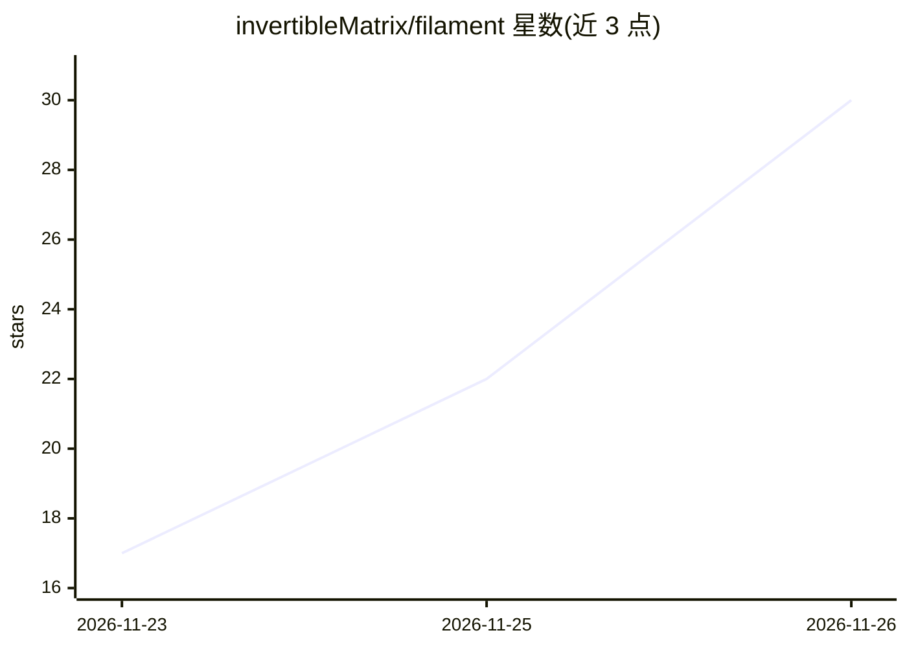

# invertibleMatrix/filament

⭐ 30 · JavaScript · Apache-2.0 · 推送 2026-11-25 · [GitHub](https://github.com/invertibleMatrix/filament) · [官网](https://filamentdev.com) · 组织维护

**开发者的 agent 编排桌面应用：多模型多 agent 共享一份记忆**

面向开发者的开源 agent harness，提供 Windows/macOS/Linux 桌面应用与 Linux 服务器版本。自带编码 agent 可接任意有 key 或订阅的模型，把大任务拆成任务图并行分发；Claude Code、Codex、Cursor、Antigravity、Devin 及 ACP agent 可在其中用已有订阅运行；所有模型与 agent 共享一份本地加密记忆。另提供 Anthropic/OpenAI 格式的本地 API 端口供其他工具接入。自我报告的缓存命中率与加速数据来自作者自用，非公开基准。

## 筛选速览

| 维度 | 判定 | 备注 |
|---|---|---|
| AI 角色 | `ai-ecosystem` | LLM/agent 周边工具 |
| 许可风险 | `permissive` | Apache-2.0 |
| 部署形态 | `library` | 以包/库形式分发 |
| 模型依赖 | local-ok | 支持本地模型 |
| 硬件要求 | — | 无带数字的原话,不猜 |
| 安装摩擦 | `low` | 无编译、无系统依赖或容器化 |
| 成熟度 | — | 结构信号不足 |

## 能力要点

- 自带编码 agent：任务图拆解 + git worktree 并行施工
- 一份跨模型/跨 agent 的共享记忆，本地加密存储
- Claude Code/Codex/Cursor/Devin/ACP agent 可在应用内运行
- 提供 Anthropic/OpenAI 格式本地 API，供外部 SDK 接入已连接的全部模型

## 适用场景

- 把一个大需求拆给多个编码 agent 并行完成
- 让多个模型/agent 会话间延续项目记忆与规则
- 通过本地 API 让既有工具统一访问已配置的多家模型
- 查看每轮上下文窗口、缓存命中与文件 diff 并可回退

## 场景标签

`多智能体` `编码 Agent` `Agent 记忆` · 领域:Agent 开发

## 证据(README 行号)

> L10: Filament is an open-source agent harness for developers: a desktop app for Windows, macOS and Linux, and a server f
> L31: 3. **A local API for your other tools**: one address on your computer for any Anthropic- or OpenAI-format client, w
> L49: ## Claude Code, Codex, Cursor, Antigravity, Devin and Any ACP Agent inside Filament with any number of accounts sig

## 星数曲线

2026-11-23 17 → 2026-11-26 30（+13）

---
*卡片 v1 · prompt 1.4 · 生成 2026-11-23 · 置信度 high · 依据 README sha `99f1abc23093` · [字段定义](../../DATASET.md)*
