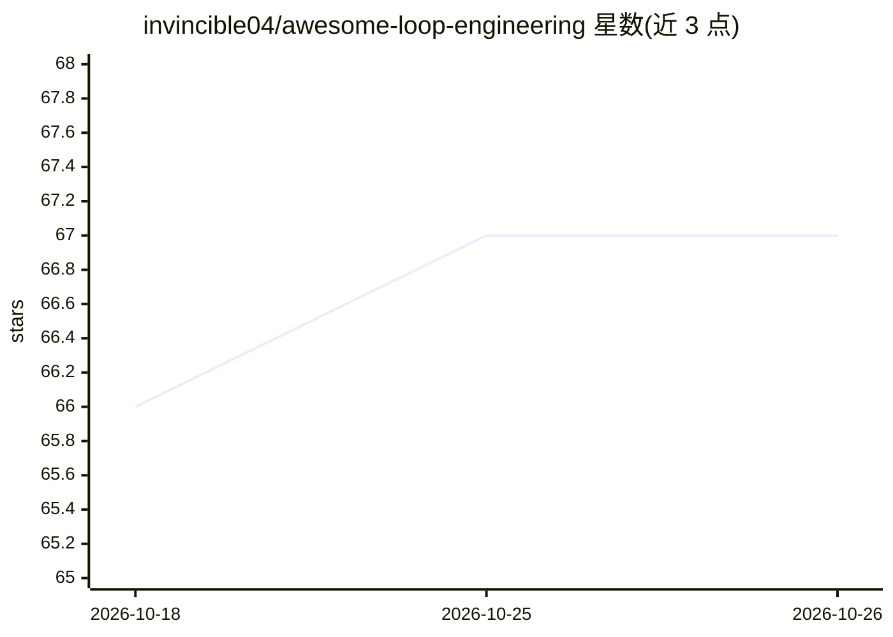

# invincible04/awesome-loop-engineering

⭐ 67 · HTML · MIT · 推送 2026-06-22 · [GitHub](https://github.com/invincible04/awesome-loop-engineering) · [官网](https://invincible04.github.io/awesome-loop-engineering/) · 个人维护

**循环工程教学仓库：教你构建自动驱动编码代理的系统**

面向日常使用编码代理（Claude Code、Codex、Cursor 等）的开发者的教学仓库，主题为 loop engineering——用系统代替人工反复提示代理。内容分四部分：循序渐进的章节、约 100 条带注释的阅读清单、可直接复制的循环提示库（Ralph loops、/goal、maker/checker 等），以及一个可移植的 agent skill（通过 npx 安装，访谈式生成 11 部分 loop contract 并脚手架文件），另附纯标准库 Python 可运行示例与测试。MIT 许可，接受 PR。

## 筛选速览

| 维度 | 判定 | 备注 |
|---|---|---|
| AI 角色 | `ai-knowledge` | 知识聚合/清单类 |
| 许可风险 | `permissive` | MIT |
| 部署形态 | `library` | 以包/库形式分发 |
| 模型依赖 | — | README 未给出锁定关系 |
| 硬件要求 | — | 无带数字的原话,不猜 |
| 安装摩擦 | `low` | 无编译、无系统依赖或容器化 |
| 成熟度 | `idea` | |

## 能力要点

- 四层谱系（prompt→context→harness→loop）的章节化教学文档
- 约 100 条带注释的阅读清单覆盖论文/评测/演讲/质疑方
- prompts/ 库收集可复制的循环提示与完整 loop contract
- 可移植 agent skill：npx 一键安装，兼容 Claude Code/Codex/Cursor/OpenCode

## 适用场景

- 我每天用编码代理，想停止手工逐轮提示
- 想为固定工作（CI 修复、issue 分诊、PR 看护）搭建自动循环
- 想系统学习 loop engineering 的概念、风险与验证方法

## 场景标签

`提示工程` `教程课程` · 领域:Agent 开发

## 证据(README 行号)

> L19: This is a **teaching repo**, not a link dump. It has four parts:
> L22: 2. **Read** — a large, annotated reading list (~100 sources): the essays that named the field, the papers it stands
> L128: The **loop-engineering skill** is a portable agent skill you can drop into Claude Code, Codex, Cursor, or OpenCode

## 星数曲线

2026-10-18 66 → 2026-10-26 67（+1）

---
*卡片 v1 · prompt 1.4 · 生成 2026-10-24 · 置信度 high · 依据 README sha `ab81d879b124` · [字段定义](../../DATASET.md)*
