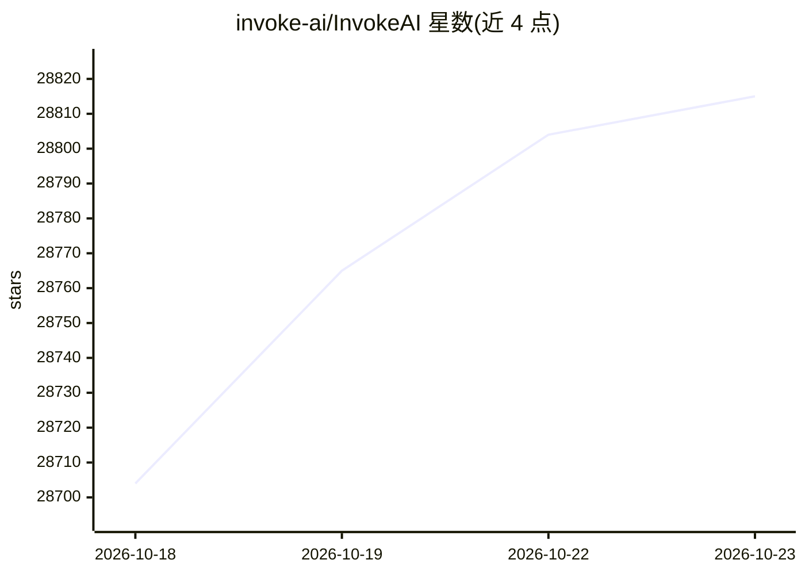

# invoke-ai/InvokeAI

⭐ 28,815 · TypeScript · Apache-2.0 · 推送 2026-10-22 · [GitHub](https://github.com/invoke-ai/InvokeAI) · [官网](https://invoke-ai.github.io/InvokeAI/) · 组织维护

**面向创作者的 Stable Diffusion 本地图像生成 WebUI 与工作流工具**

Invoke 是一个基于 Stable Diffusion 系列模型的本地图像生成引擎：在本机运行 Web 服务器与 React UI，提供统一画布（内绘/外绘、笔刷工具）、节点式工作流管理与图库管理。支持 ckpt、diffusers 及部分 gguf 格式模型，覆盖 SD 1.5 至 Flux.2、Z-Image、Qwen Image 等二十余个模型，其中 Nano Banana、GPT Image、Wan 仅经 API 调用。采用商业友好许可证，通过专用 Launcher 下载安装，并作为多个商业产品的基础。

## 筛选速览

| 维度 | 判定 | 备注 |
|---|---|---|
| AI 角色 | `ai-native` | 本体是模型或模型工具 |
| 许可风险 | `permissive` | Apache-2.0 |
| 部署形态 | `None` |  |
| 模型依赖 | — | README 未给出锁定关系 |
| 硬件要求 | — | 无带数字的原话,不猜 |
| 安装摩擦 | `low` | 无编译、无系统依赖或容器化 |
| 成熟度 | — | 结构信号不足 |

## 动量与使用信号

- 维护:`active` — 距上次 push 0.9 天,年发版 24,368 位贡献者
- 涨星:近 1 天 **+29**(自 20261016 起算)
- 平台:WEB · 协议:—

## 能力要点

- 本地托管 Web 服务器与 React UI
- 统一画布：内绘/外绘、笔刷工具与生成能力集成
- 节点式工作流创建、管理与分享
- 支持 20+ 图像模型及 ckpt/diffusers/gguf 格式

## 适用场景

- 本地生成与迭代 AI 图像作品
- 搭建可复用的节点式生成工作流
- 对图像做内绘/外绘编辑与放大处理

## 场景标签

`图像生成` · 领域:内容生成

## 证据(README 行号)

> L9: Invoke is a leading creative engine built to empower professionals and enthusiasts alike. Generate and create stunni
> L39: Invoke runs a locally hosted web server & React UI with an industry-leading user experience.
> L53: ### Model Support

## 星数曲线

2026-10-18 28,704 → 2026-10-23 28,815（+111）

---
*卡片 v1 · prompt 1.4 · 生成 2026-10-18 · 置信度 high · 依据 README sha `7e4cd2cc32c0` · [字段定义](../../DATASET.md)*
