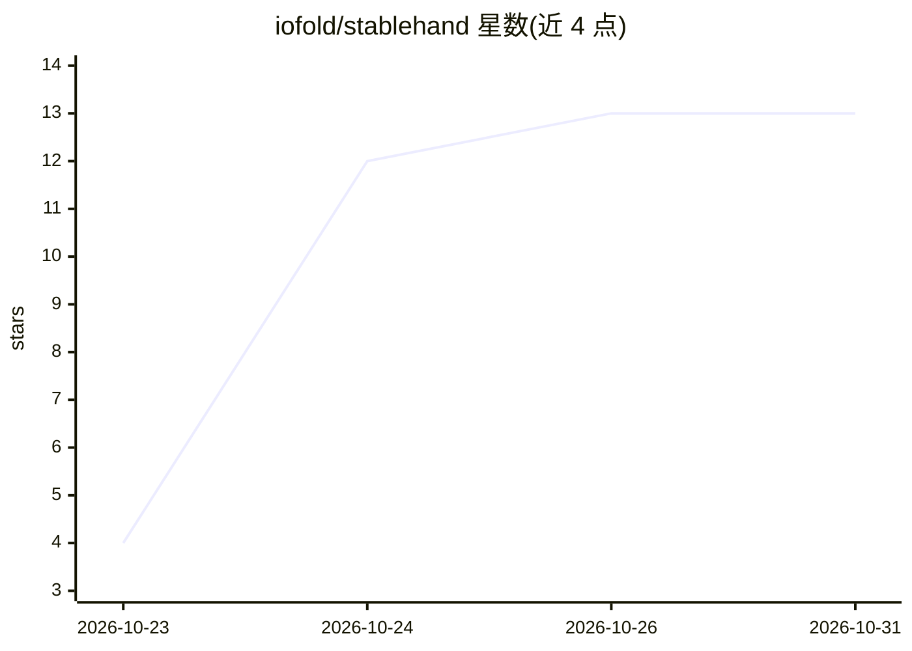

# iofold/stablehand

⭐ 13 · TypeScript · MIT · 推送 2026-10-24 · [GitHub](https://github.com/iofold/stablehand) · 组织维护

**自托管 agent 运行时：定时运行代理，带审批、预算与运行回执**

在自有服务器上以 Docker Compose 部署的 agent 运行时：用 YAML 描述 agent，按日程或事件触发，每个会话在独立 Docker 容器中运行。支持 LangGraph、Claude Agent SDK 或 Pi 作为 agent 循环；标记为有风险的工具调用等待人工在浏览器或手机上批准，预算按 agent 与标签限制花费，每轮记录模型、token、成本与审批。orchestrator（Node.js/Fastify/PostgreSQL）持有调度、触发器、审批与事件日志，沙箱经 egress 代理限定可访问主机，默认经 LiteLLM 网关计价。限制：无内置 RAG，npm 包尚未发布，审批不覆盖 Claude Agent SDK 自带的 Bash/Write/Edit 工具。

## 筛选速览

| 维度 | 判定 | 备注 |
|---|---|---|
| AI 角色 | `ai-ecosystem` | LLM/agent 周边工具 |
| 许可风险 | `permissive` | MIT |
| 部署形态 | `self-host` | docker 或自建部署 |
| 模型依赖 | locked-api |  |
| 硬件要求 | — | 无带数字的原话,不猜 |
| 安装摩擦 | `low` | 无编译、无系统依赖或容器化 |
| 成熟度 | `idea` | |

## 能力要点

- agent 会话运行在独立 Docker 容器，经 egress 代理白名单访问外网
- 人工审批卡：风险工具调用等待浏览器/手机批准，待审批在 orchestrator 重启后保留
- 按 agent 与标签的预算控制与 per-run 花费上限（依赖 LiteLLM 网关）
- 每轮记录模型、token、成本、审批与产出文件，事件持久化到 PostgreSQL

## 适用场景

- 让 agent 定时或事件触发地无人值守运行在自有服务器上
- 对有风险的操作引入手机/浏览器端人工审批流程
- 为每个 agent 设置花费上限并查看成本回执

## 场景标签

`Agent 框架` `工作流自动化` · 领域:Agent 开发

## 证据(README 行号)

> L10: Stablehand is for agents that run unattended. You describe an agent in YAML, give it a schedule or an event to reac
> L93: An orchestrator (Node.js, Fastify, PostgreSQL) holds everything that has to outlive a run: agents, schedules, trigg

## 星数曲线

2026-10-23 4 → 2026-10-31 13（+9）

---
*卡片 v1 · prompt 1.4 · 生成 2026-10-31 · 置信度 mid · 依据 README sha `b4c8532bb802` · [字段定义](../../DATASET.md)*
