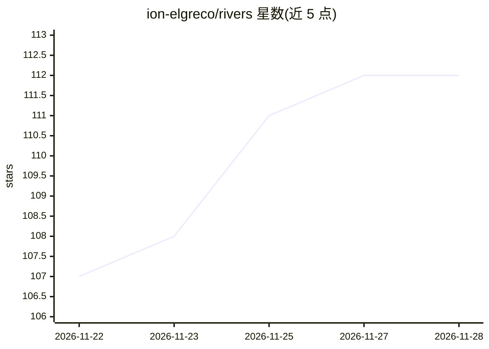

# ion-elgreco/rivers

⭐ 112 · Rust · Apache-2.0 · 推送 2026-11-26 · [GitHub](https://github.com/ion-elgreco/rivers) · [官网](https://orchestrator.rs) · 个人维护

**Rust 实现的数据与 ML 流水线编排平台，Python 定义资产**

以数据资产为核心的编排平台：用 Python 函数定义资产，图解析、执行规划、分区逻辑与调度由编译 Rust 运行，控制面不含 Python 解释器。支持静态/时间窗/多维/动态分区、Delta Lake 与 Apache Iceberg IO、并行与 K8s 分布式执行、回填与并发控制；内嵌 SurrealDB 做本地存储，生产可接 PostgreSQL。提供 K8s operator、CRD、多架构镜像与 Helm charts，`rivers dev` 单命令启动调度器与 Web UI。

## 筛选速览

| 维度 | 判定 | 备注 |
|---|---|---|
| AI 角色 | `ai-ecosystem` | LLM/agent 周边工具 |
| 许可风险 | `permissive` | Apache-2.0 |
| 部署形态 | `library` | 以包/库形式分发 |
| 模型依赖 | — | README 未给出锁定关系 |
| 硬件要求 | — | 无带数字的原话,不猜 |
| 安装摩擦 | `low` | 无编译、无系统依赖或容器化 |
| 成熟度 | — | 结构信号不足 |

## 能力要点

- 资产型编排：Python 函数定义数据资产，自动解析依赖图
- Rust 核心处理图解析、执行规划与调度，数千节点图亚毫秒规划
- 内置 Delta Lake（merge）与 Apache Iceberg（upsert）IO 处理器
- K8s operator + CRD，发布多架构镜像与 Helm charts

## 适用场景

- 用 Python 定义数据资产并自动编排依赖图
- 在 Kubernetes 上按 pod-per-step 方式运行分布式流水线
- 对 Delta Lake / Iceberg 表做带分区回填的 ETL
- 本地单进程开发调试：一条命令起调度器与 Web UI

## 场景标签

`工作流自动化` `MLOps` · 领域:效率与自动化

## 证据(README 行号)

> L3: **Orchestration platform for tasks and assets, fully backed by Rust.**
> L5: rivers is a Rust-powered orchestration platform built around data assets. Define pipelines in Python; rivers resolve
> L16: - **Rust core** — graph resolution, execution planning, partition logic, and the scheduler all run in compiled Rust

## 星数曲线

2026-11-22 107 → 2026-11-28 112（+5）

---
*卡片 v1 · prompt 1.4 · 生成 2026-11-28 · 置信度 high · 依据 README sha `97b95a3e7772` · [字段定义](../../DATASET.md)*
