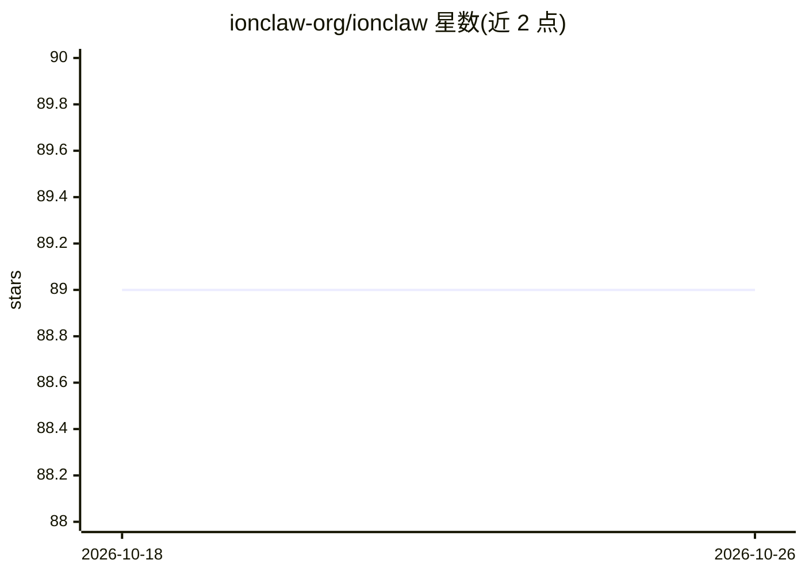

# ionclaw-org/ionclaw

⭐ 89 · C++ · MIT · 推送 2026-08-05 · [GitHub](https://github.com/ionclaw-org/ionclaw) · [官网](https://ionclaw.com) · 个人维护

**C++ 编写的跨平台多智能体编排器，手机/服务器均可原生运行**

用 C++20 从零构建的 AI agent 编排平台：单一代码库编译为 Linux/macOS/Windows 原生服务端（一条命令启动并自动提供 Web 控制面板），iOS/Android/tvOS/watchOS 应用内嵌同一引擎在设备本地运行。功能包括多 agent 管理、实时任务板、Markdown 技能系统、浏览器自动化、调度器、子 agent、持久记忆、沙箱文件管理、MCP Server/Client，支持 Anthropic/OpenAI/Gemini/Grok/DeepSeek/Ollama 及 OpenAI 兼容端点等多种模型提供方。构建需 CMake 3.25+、C++20 编译器、Perl 与 Node.js 20.19+，文档另载 Homebrew/Docker/Flutter 等安装方式。面向需要自托管 agent 自动化的开发者和用户，MIT 许可。

## 筛选速览

| 维度 | 判定 | 备注 |
|---|---|---|
| AI 角色 | `ai-ecosystem` | LLM/agent 周边工具 |
| 许可风险 | `permissive` | MIT |
| 部署形态 | `self-host` | docker 或自建部署 |
| 模型依赖 | local-ok | 支持本地模型 |
| 硬件要求 | — | 无带数字的原话,不猜 |
| 安装摩擦 | `low` | 无编译、无系统依赖或容器化 |
| 成熟度 | — | 结构信号不足 |

## 能力要点

- 单一代码库原生编译到 Linux/macOS/Windows/iOS/Android/tvOS/watchOS，无外部运行时依赖
- 多 agent、子 agent、调度器、持久记忆与沙箱文件管理
- 同时实现 MCP Server 与 Client，可被 Claude Code/Cursor/Copilot 等客户端调用
- 浏览器自动化与 Markdown 技能扩展系统

## 适用场景

- 在自有服务器上一条命令启动带 Web 面板的多 agent 自动化平台
- 在手机上本地运行个人 AI 助手，数据留在设备端
- 通过 MCP 协议把 agent 暴露给 Claude Code、Cursor 等开发工具使用

## 场景标签

`多智能体` `Agent 框架` `浏览器自动化` `工作流自动化` · 领域:Agent 开发

## 证据(README 行号)

> L13:  A C++ AI agent orchestrator that runs anywhere as a native build — Linux, macOS, Windows, iOS, Android, tvOS, and 
> L34: - **Multi-agent** — run multiple agents with independent models, tools, and workspaces
> L44: - **MCP Server** — expose agents via the Model Context Protocol for use with Claude Code, Cursor, GitHub Copilot, a

## 星数曲线

2026-10-18 89 → 2026-10-26 89（+0）

---
*卡片 v1 · prompt 1.4 · 生成 2026-10-23 · 置信度 high · 依据 README sha `a588de3bb327` · [字段定义](../../DATASET.md)*
