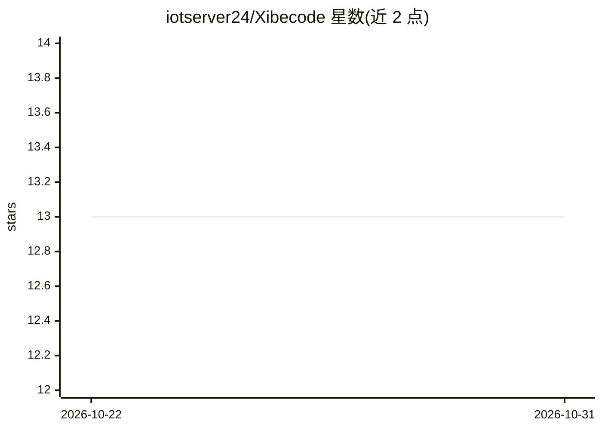

# iotserver24/Xibecode

⭐ 13 · TypeScript · Apache-2.0 · 推送 2026-09-01 · [GitHub](https://github.com/iotserver24/Xibecode) · [官网](https://xibeai.in) · 个人维护

**终端自主编程代理：用 LLM 读写代码、跑命令、迭代完成任务**

面向开发者的 CLI 编程代理，monorepo 结构含 xibecode-core 引擎库与 xibecode CLI 两个包。核心机制：自主多步 agent 循环（默认不限迭代数）、50+ 工具（文件 I/O、git、shell、web 搜索、MCP）、13 种 agent 模式（当前开放 agent/plan/review 三种）、生命周期钩子、自动记忆与多源分层配置。支持 Anthropic、OpenAI、Google、Groq 及自定义 OpenAI 兼容提供商；含 MCP server 集成、40+ 内置技能、并行 swarm 编排与 GitHub PR 自动创建（需 gh CLI）。需 Node.js 18+ 与 API key。

## 筛选速览

| 维度 | 判定 | 备注 |
|---|---|---|
| AI 角色 | `ai-native` | 本体是模型或模型工具 |
| 许可风险 | `permissive` | Apache-2.0 |
| 部署形态 | `library` | 以包/库形式分发 |
| 模型依赖 | locked-api |  |
| 硬件要求 | — | 无带数字的原话,不猜 |
| 安装摩擦 | `low` | 无编译、无系统依赖或容器化 |
| 成熟度 | — | 结构信号不足 |

## 能力要点

- 自主多步 agent 循环，50+ 工具与 MCP server 集成
- 多提供商支持（Anthropic/OpenAI/Google/Groq/自定义）
- 13 种 agent 模式、生命周期钩子与自动记忆系统
- xibecode-core 可独立作为库构建自定义编程工具

## 适用场景

- 在终端让 AI 自主完成构建、修复、测试等编程任务
- 自动创建分支并提 GitHub PR 的无人值守编码流程
- 通过 Telegram/Discord/Slack 网关与定时任务远程驱动编码代理

## 场景标签

`编码 Agent` `多智能体` · 领域:Agent 开发

## 证据(README 行号)

> L10: XibeCode is a CLI agent that reads and edits code, runs commands, and iterates on tasks from your terminal using LL
> L195: - **Autonomous multi-step agent loop** - Completes complex tasks automatically

## 星数曲线

2026-10-22 13 → 2026-10-31 13（+0）

---
*卡片 v1 · prompt 1.4 · 生成 2026-10-31 · 置信度 high · 依据 README sha `0cdffd11a288` · [字段定义](../../DATASET.md)*
