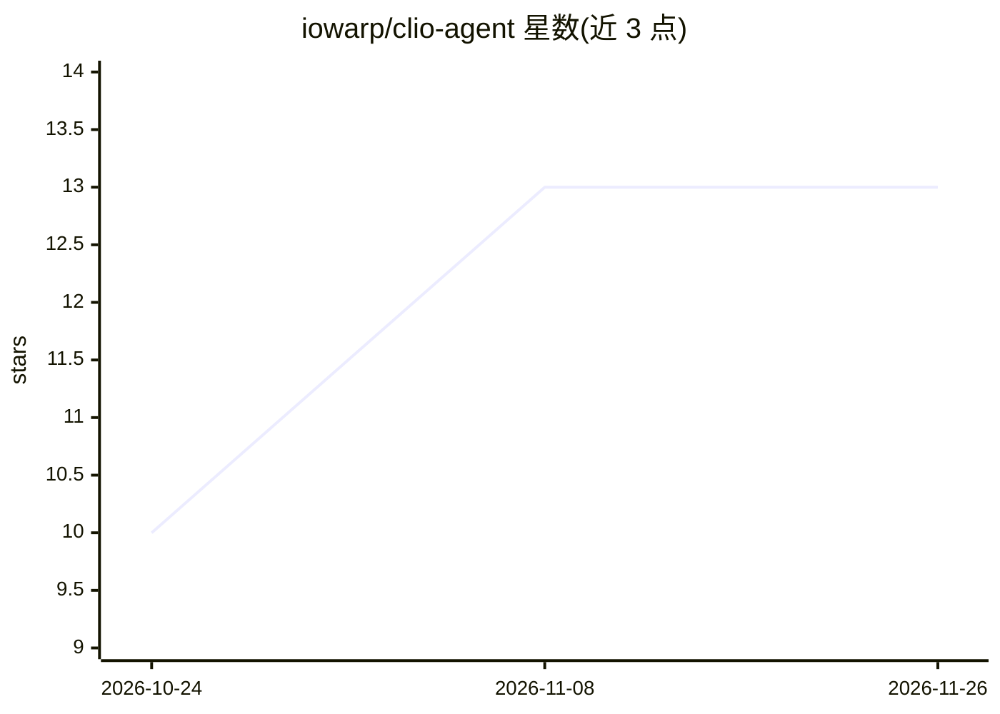

# iowarp/clio-agent

⭐ 13 · HTML · NOASSERTION · 推送 2026-11-25 · [GitHub](https://github.com/iowarp/clio-agent) · [官网](https://clio.iowarp.ai) · 组织维护

**科研数据的 AI 工作区：管理文件、分析与可视化**

CLIO 是 IOWarp 下的科研数据 AI 工作区，提供 Desktop 与浏览器两种形态，用户通过连接本地模型、provider 账号或实验室模型服务来处理文件、分析、可视化与文档。核心机制包括 workspace/会话组织与持久化 ARC 记忆、marketplace 插件与 agents/tools/flows 扩展、通过 MCP 工具读取 HDF5/Parquet/CSV 数据，并支持在数据所在位置（本地或远程）运行工具。安装依赖 Python 3.14 与 uv；旧版 TUI 自 0.9.5.1 起冻结不再支持。

## 筛选速览

| 维度 | 判定 | 备注 |
|---|---|---|
| AI 角色 | `ai-ecosystem` | LLM/agent 周边工具 |
| 许可风险 | `none` | NOASSERTION |
| 部署形态 | `self-host` | docker 或自建部署 |
| 模型依赖 | — | README 未给出锁定关系 |
| 硬件要求 | — | 无带数字的原话,不猜 |
| 安装摩擦 | `low` | 无编译、无系统依赖或容器化 |
| 成熟度 | — | 结构信号不足 |

## 能力要点

- Desktop（Windows/Apple Silicon macOS/Linux）与 Web 镜像双形态部署
- MCP 工具读取 HDF5、Parquet 与 CSV 数据
- marketplace 插件与 agents/tools/flows 扩展机制，持久化 ARC 记忆
- 工具可在数据所在的本地或远程环境运行

## 适用场景

- 在桌面或浏览器中组织科研数据的分析会话
- 通过 MCP 工具检查 HDF5/Parquet/CSV 数据集
- 在远程计算节点上就地运行数据处理工具
- 为通用 AI agent 提供规模化数据管理能力

## 场景标签

`科研工具` `数据分析` · 领域:效率与自动化

## 证据(README 行号)

> L9: Connect a local model, a provider account, or a model service from your lab.
> L12: - Extend CLIO with marketplace plugins, agents, tools and flows.
> L13: - Inspect HDF5, Parquet and CSV data through MCP tools.

## 星数曲线

2026-10-24 10 → 2026-11-26 13（+3）

---
*卡片 v1 · prompt 1.4 · 生成 2026-11-18 · 置信度 mid · 依据 README sha `2161f1b079af` · [字段定义](../../DATASET.md)*
