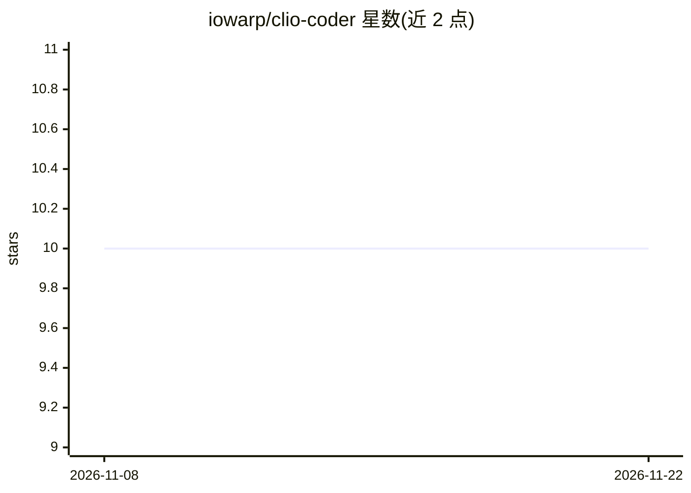

# iowarp/clio-coder

⭐ 10 · TypeScript · Apache-2.0 · 推送 2026-11-19 · [GitHub](https://github.com/iowarp/clio-coder) · [官网](https://coder.iowarp.ai) · 组织维护

**开源编码 Agent：科研软件与日常工程的可核查代码执行**

面向开发者与科研团队的编码 Agent，统一承载项目规则、工具、检查与安全控制，可切换底层模型（本地 GPU、实验室网关或云 API）而配置不变。提供终端、脚本/CI（JSONL 与退出码）、ACP 编辑器、桌面应用（alpha）四种入口；支持向多模型或 Claude Code 等 worker 派发有界任务，每次运行生成可校验的密封执行记录（evidence inspect / telemetry verify）。运行测试、数值比对与复现检查并记录未核验项。无账号、Apache-2.0。

## 筛选速览

| 维度 | 判定 | 备注 |
|---|---|---|
| AI 角色 | `ai-ecosystem` | LLM/agent 周边工具 |
| 许可风险 | `permissive` | Apache-2.0 |
| 部署形态 | `library` | 以包/库形式分发 |
| 模型依赖 | local-ok | 支持本地模型 |
| 硬件要求 | — | 无带数字的原话,不猜 |
| 安装摩擦 | `low` | 无编译、无系统依赖或容器化 |
| 成熟度 | `idea` | |

## 能力要点

- 任意模型接入：Ollama/vLLM/llama.cpp、实验室网关、云 API 与已有订阅，/model 切换
- 四入口共享配置：终端、run（CI/脚本）、acp（编辑器）、gui（桌面 alpha）
- 每次运行密封执行记录，可在任意机器复核
- 小窗口上下文管理：先逐出可精确回溯的工具输出
- HPC 支持：无 root 安装、Slurm/Lmod/Spack 技能包、HDF5/NetCDF 数据读取

## 适用场景

- 在 HPC 登录节点无 root 安装，用本地或集群模型改科学代码
- 让 Agent 修复失败测试并给出 diff 与运行证据
- 同一项目跨模型批量跑 campaign 比较表现
- CI 中以脚本方式运行有界编码任务并取回结构化输出

## 场景标签

`编码 Agent` · 领域:编码与开发

## 证据(README 行号)

> L7: CLIO Coder is for developers and research teams who want one set of project
> L37: - **Any model, local to frontier.** Ollama, vLLM or llama.cpp on your own
> L41: - **One agent, four ways in.** `clio-coder` in the terminal,

## 星数曲线

2026-11-08 10 → 2026-11-22 10（+0）

---
*卡片 v1 · prompt 1.4 · 生成 2026-11-20 · 置信度 high · 依据 README sha `82b1a0c1901f` · [字段定义](../../DATASET.md)*
