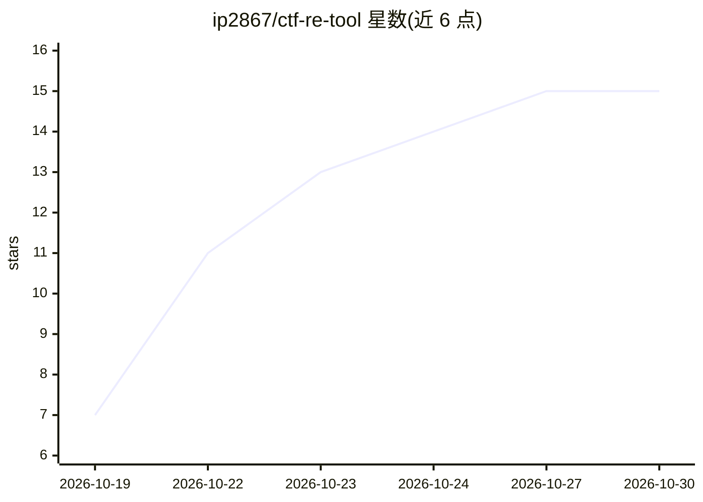

# ip2867/ctf-re-tool

⭐ 15 · JavaScript · MIT · 推送 2026-10-27 · [GitHub](https://github.com/ip2867/ctf-re-tool) · [官网](https://github.com/ip2867/ctf-re-tool/releases) · 个人维护 · 中文 README

**Windows 桌面 CTF 逆向 AI 解题工作台，AI 调度工具自动解题**

基于 Electron 的 Windows 桌面应用，面向 CTF 选手与安全研究人员：AI 通过 Tool-Use 循环自主调用 IDA/JEB/Frida/Python 等工具，按四阶段流程推进解题，并通过 MCP 实时接入 IDA/JEB/Burp。支持 APK/PE/ELF/PYC/DEX/JAR/Mach-O/Lua/WASM 等格式自动识别，内置 11 个方法论技能与 50 条结构化知识库条目，flag 需经本地 Python 复现验证并标注已验证/未验证。本身是调度框架，不含 IDA/JEB/Burp 等外部工具，需在设置页配置路径与 Anthropic 兼容 API。提供单文件便携 exe，也可 npm 打包或源码运行。

## 筛选速览

| 维度 | 判定 | 备注 |
|---|---|---|
| AI 角色 | `ai-native` | 本体是模型或模型工具 |
| 许可风险 | `permissive` | MIT |
| 部署形态 | `desktop` | 安装包/桌面程序 |
| 模型依赖 | locked-api |  |
| 硬件要求 | — | 无带数字的原话,不猜 |
| 安装摩擦 | `low` | 无编译、无系统依赖或容器化 |
| 成熟度 | — | 结构信号不足 |

## 能力要点

- AI Tool-Use 循环四阶段推进（收集→定位算法→本地验证→结论）
- MCP 接入 IDA/JEB/Burp，含调试器断点、单步与读写内存
- flag 附 [VERIFY] 契约，自动生成 Python 脚本本地复现并标注验证状态
- 内置 11 个方法论技能 + 50 条结构化知识库，解题经验自动入库复用

## 适用场景

- CTF 比赛中自动分析 APK/PE/ELF 等逆向题并验证 flag
- 授权渗透测试或自有系统的安全研究中自动化逆向分析
- 让 AI 编排 Frida Hook、解密脚本与反调试绕过流程

## 场景标签

`网络安全` · 领域:学习与行业

## 证据(README 行号)

> L10: 设计原则：**AI 是解题主体，工具提供能力**。不是把功能堆在一起，而是让 AI 在解题过程中真正调用工具、识别算法、验证结论。
> L12: - **AI 工具循环（Tool-Use）**：AI 自主调用 JEB/IDA/Frida/Python 等工具反复推进，而不是一次性问答；分阶段提示词（①收集 → ②定位算法 → ③写脚本本地验证 → ④结论）。
> L67: 兼容 CCSwitch / Claude Code 的 Anthropic `/v1/messages` 接口，SSE 流式输出，可随时中断。

## 星数曲线

2026-10-19 7 → 2026-10-30 15（+8）

---
*卡片 v1 · prompt 1.4 · 生成 2026-10-30 · 置信度 high · 依据 README sha `bcb240a12b64` · [字段定义](../../DATASET.md)*
