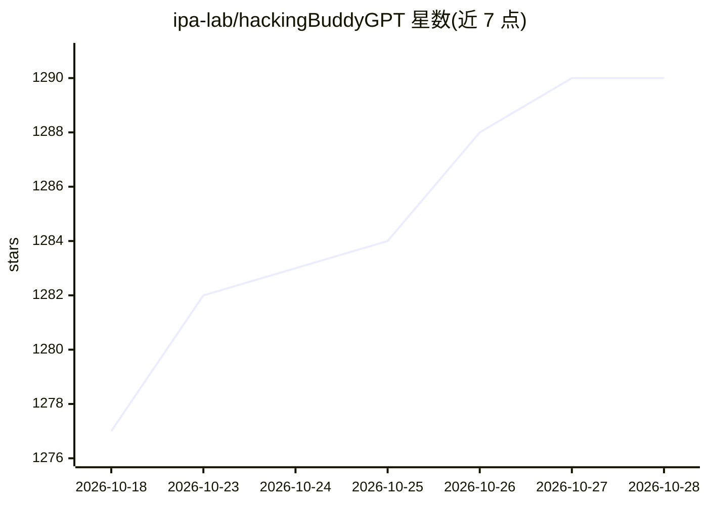

# ipa-lab/hackingBuddyGPT

⭐ 1,290 · Python · MIT · 推送 2026-10-24 · [GitHub](https://github.com/ipa-lab/hackingBuddyGPT) · [官网](https://hackingbuddy.ai/) · 组织维护

**构建 LLM 驱动安全测试 agent 的框架（约 50 行代码起步）**

面向安全研究者与渗透测试人员的开源 Python 框架，提供 LLM 连接（经 litellm 统一上游）、目标连接器（SSH/本地 shell/psexec）、能力/工具接线、运行限制与结构化日志，使新实验（use-case）以数十行代码表达。内置 Linux/Windows 提权、Web/API 测试、Active Directory 假设失陷等 use-case，以 wintermute CLI 子命令运行；支持 Docker 镜像与 Docker-fleet 基准测试。注意：会在真实系统上执行命令，仅限授权环境使用。

## 筛选速览

| 维度 | 判定 | 备注 |
|---|---|---|
| AI 角色 | `ai-ecosystem` | LLM/agent 周边工具 |
| 许可风险 | `permissive` | MIT |
| 部署形态 | `self-host` | docker 或自建部署 |
| 模型依赖 | local-ok | 支持本地模型 |
| 硬件要求 | — | 无带数字的原话,不猜 |
| 安装摩擦 | `low` | 无编译、无系统依赖或容器化 |
| 成熟度 | — | 结构信号不足 |

## 能力要点

- litellm 统一 LLM 上游，支持 OpenRouter（默认）/OpenAI/Anthropic/本地 Ollama 等
- 两种执行风格：原生 tool-calling agent 与 Mako 模板命令策略
- 四层配置覆盖与 OpenTelemetry/GenAI JSONL 自包含日志
- 提权成功判定对照 ground-truth 验证，防止虚假成功

## 适用场景

- 用数十行代码实现新的 LLM 渗透测试实验
- 对自有靶机跑 Linux/Windows 提权、Web 与 API 渗透 use-case
- 对一批 Docker 靶机做回归基准测试并生成报告

## 场景标签

`网络安全` `Agent 框架` · 领域:Agent 开发

## 证据(README 行号)

> L11: **hackingBuddyGPT** is an open-source framework for building LLM-driven security-testing agents. It gives you the b
> L68: - **One LLM upstream: litellm.** Any provider is reachable through the `llm.model` string — OpenAI, OpenRouter (the

## 星数曲线

2026-10-18 1,277 → 2026-10-28 1,290（+13）

---
*卡片 v1 · prompt 1.4 · 生成 2026-10-21 · 置信度 mid · 依据 README sha `0b8ef58cf65f` · [字段定义](../../DATASET.md)*
