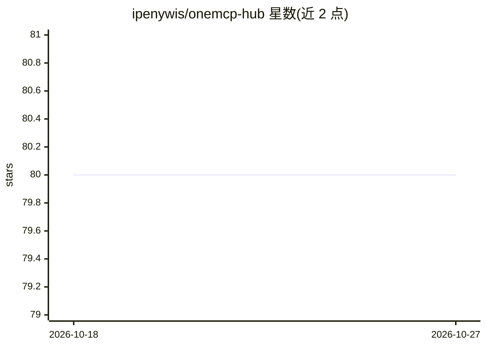

# ipenywis/onemcp-hub

⭐ 80 · 推送 2025-12-23 · [GitHub](https://github.com/ipenywis/onemcp-hub) · [官网](https://onemcp.io) · 组织维护

**OneMCP 桌面应用的社区问题与功能请求跟踪仓库**

OneMCP Hub 是 OneMCP 桌面应用（AI/MCP 相关主题）的社区中心仓库，不包含产品代码本身。功能限定为：用户通过 Issues 的 Bug Report、Feature Request、New MCP Proposal 三种模板提交问题、功能请求与新的 MCP 提案，由 OneMCP 团队用 triage/accepted/in-progress/needs-more-info 标签跟踪状态。仓库以 MIT 许可发布，面向 OneMCP 的用户与贡献者。

## 筛选速览

| 维度 | 判定 | 备注 |
|---|---|---|
| AI 角色 | `ai-ecosystem` | LLM/agent 周边工具 |
| 许可风险 | `none` | — |
| 部署形态 | `None` |  |
| 模型依赖 | — | README 未给出锁定关系 |
| 硬件要求 | — | 无带数字的原话,不猜 |
| 安装摩擦 | `low` | 无编译、无系统依赖或容器化 |
| 成熟度 | — | 结构信号不足 |

## 能力要点

- 提供 Bug Report / Feature Request / New MCP Proposal 三种议题模板
- 用标签（triage/accepted/in-progress/needs-more-info）跟踪提交状态
- 由 OneMCP 团队审核所有提交

## 适用场景

- 作为 OneMCP 用户报告 bug 或异常行为
- 请求 OneMCP 增加新功能
- 提议将新的 MCP 加入平台

## 场景标签

 · 领域:LLM 工具生态/MCP

## 证据(README 行号)

> L3: A central repository for OneMCP users to report issues, request features, and propose new MCPs.
> L10: - Proposing new MCPs to be added to the platform

## 星数曲线

2026-10-18 80 → 2026-10-27 80（+0）

---
*卡片 v1 · prompt 1.4 · 生成 2026-10-24 · 置信度 mid · 依据 README sha `8bfeb54b9a94` · [字段定义](../../DATASET.md)*
