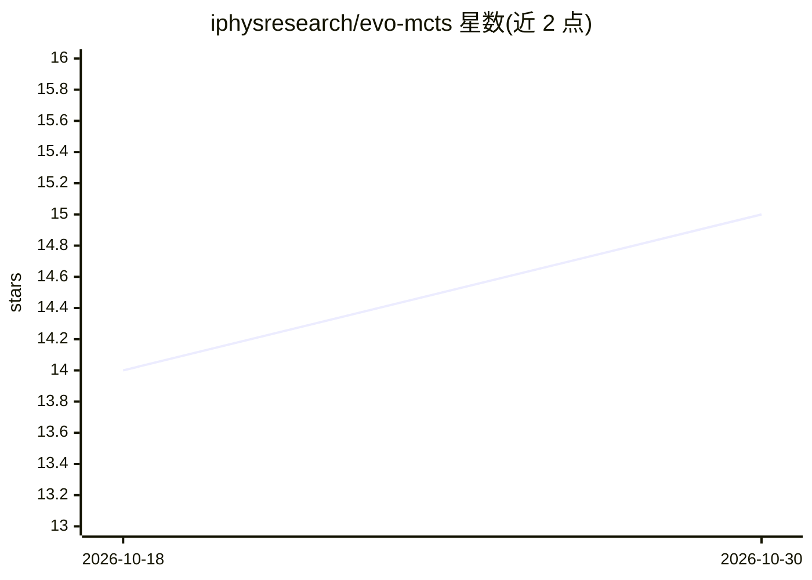

# iphysresearch/evo-mcts

⭐ 15 · Python · GPL-3.0 · 推送 2026-09-10 · [GitHub](https://github.com/iphysresearch/evo-mcts) · [官网](https://iphysresearch.github.io/evo-mcts/) · 个人维护 · 中文 README

**论文官方实现：LLM 引导的演化 MCTS 自动发现引力波检测算法**

arXiv:2508.03661 的开源实现，面向引力波信号检测的自动算法发现框架 Evo-MCTS：以 LLM 提供指导并结合领域物理约束，通过蒙特卡洛树搜索与演化优化系统探索算法解空间，生成可解释的检测流水线。作者来自中国科学院大学与清华大学。使用 conda 环境（Python 3.12）与 Hydra 配置，需配置 OpenAI 类 LLM API key，并克隆 MLGWSC-1 仓库生成 HDF5 数据集；仓库含完整 MCTS 树数据与 5 次生产运行的执行日志用于复现，支持添加新问题、接入新 LLM 与调整演化参数。

## 筛选速览

| 维度 | 判定 | 备注 |
|---|---|---|
| AI 角色 | `ai-ecosystem` | LLM/agent 周边工具 |
| 许可风险 | `viral` | GPL-3.0 |
| 部署形态 | `None` |  |
| 模型依赖 | locked-api |  |
| 硬件要求 | — | 无带数字的原话,不猜 |
| 安装摩擦 | `low` | 无编译、无系统依赖或容器化 |
| 成熟度 | — | 结构信号不足 |

## 能力要点

- LLM 指导结合物理约束的演化蒙特卡洛树搜索框架
- MLGWSC-1 基准上 PT-4 结果 5241.37 Mpc（相对最强基线报告提升 20.2%）
- 归档完整 MCTS 树数据（38 个算法节点）与执行日志，支持复现
- 可通过配置接入新的 LLM 客户端与新增检测问题

## 适用场景

- 复现论文中的引力波检测算法发现实验
- 在此基础上扩展其他计算科学领域的自动算法发现
- 分析 MCTS 搜索树结构研究算法发现机制

## 场景标签

`科研工具` · 领域:学习与行业

## 证据(README 行号)

> L9: **Official implementation of "Automated Algorithmic Discovery for Gravitational-Wave Detection Guided by LLM-Informe
> L142: Our framework represents the first integration of LLM guidance with evolutionary search for gravitational wave det

## 星数曲线

2026-10-18 14 → 2026-10-30 15（+1）

---
*卡片 v1 · prompt 1.4 · 生成 2026-10-30 · 置信度 high · 依据 README sha `6c7e57f6a941` · [字段定义](../../DATASET.md)*
