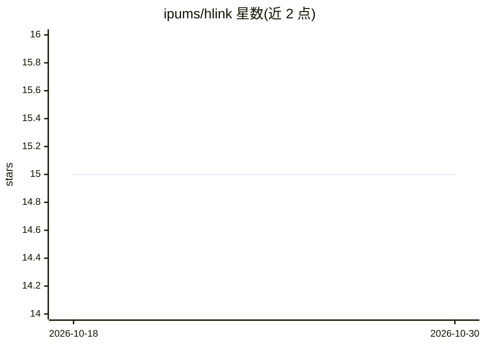

# ipums/hlink

⭐ 15 · Python · MPL-2.0 · 推送 2026-09-22 · [GitHub](https://github.com/ipums/hlink) · 组织维护

**配置驱动的概率记录链接 Python 包，用 PySpark 大规模匹配记录**

hlink 是一个配置驱动的概率记录链接 Python 包，基于 PySpark 实现大规模链接，覆盖预处理、过滤、训练、模型探索、blocking、特征生成与打分全流程。提供高层 Python API 与独立命令行接口，用户可通过 TOML 配置文件运行链接任务，可选安装 XGBoost/LightGBM 扩展模型。由 IPUMS（明尼苏达大学）维护，用于链接美国历史人口普查数据，也可用于任意记录链接任务。依赖 Python 3.11/3.12 与 Java 8+。

## 筛选速览

| 维度 | 判定 | 备注 |
|---|---|---|
| AI 角色 | `ai-native` | 本体是模型或模型工具 |
| 许可风险 | `permissive` | MPL-2.0 |
| 部署形态 | `library` | 以包/库形式分发 |
| 模型依赖 | — | README 未给出锁定关系 |
| 硬件要求 | — | 无带数字的原话,不猜 |
| 安装摩擦 | `medium` | 含编译或系统依赖之一 |
| 成熟度 | — | 结构信号不足 |

## 能力要点

- 覆盖预处理到打分的完整记录链接流程
- 基于 PySpark 的规模化执行与 blocking
- 提供 Python API 与无需编程的命令行接口
- 可选 XGBoost/LightGBM 梯度提升模型扩展

## 适用场景

- 历史人口普查等大规模数据的记录链接
- 通过配置文件运行概率记录匹配任务
- 在链接流程中训练并探索分类模型

## 场景标签

 · 领域:数据工程/记录链接

## 证据(README 行号)

> L5: hlink is a Python package that provides a flexible, configuration-driven solution to probabilistic record linking at
> L7: It is used at IPUMS to link U.S. historical census data, but can be applied to any record linkage job.

## 星数曲线

2026-10-18 15 → 2026-10-30 15（+0）

---
*卡片 v1 · prompt 1.4 · 生成 2026-10-30 · 置信度 high · 依据 README sha `782b4e948dc4` · [字段定义](../../DATASET.md)*
