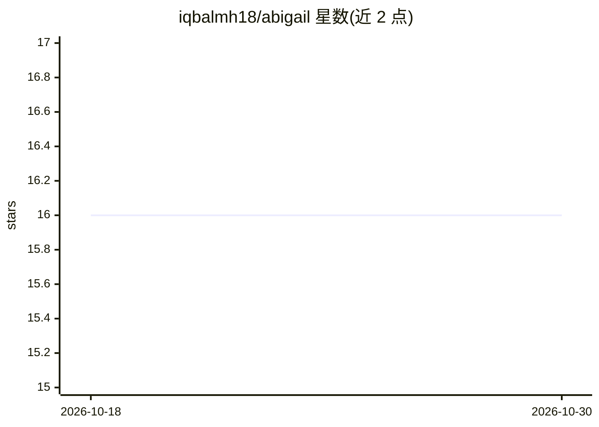

# iqbalmh18/abigail

⭐ 16 · Python · MIT · 推送 2026-07-25 · [GitHub](https://github.com/iqbalmh18/abigail) · [官网](https://pypi.org/project/abigail) · 个人维护

**免 API key 调用免费 Web AI 服务的 CLI 与 Python 库**

Abigail 是命令行工具与异步 Python 库，通过第三方公共 Web AI 接口访问聊天模型、图像与视频生成，声明无需 API key。支持多提供商（deepai、heckai、notrack、perchance 等）的自动故障转移、429/5xx 重试与熔断跳过，CLI 覆盖 chat、imagen、vidgen、交互会话、基准测试与 TOML 配置。图像与视频生成依赖 nodriver 驱动 Chromium 解决浏览器挑战；README 附免责声明要求遵守各服务条款。Python ≥ 3.12，MIT 许可。

## 筛选速览

| 维度 | 判定 | 备注 |
|---|---|---|
| AI 角色 | `ai-ecosystem` | LLM/agent 周边工具 |
| 许可风险 | `permissive` | MIT |
| 部署形态 | `library` | 以包/库形式分发 |
| 模型依赖 | — | README 未给出锁定关系 |
| 硬件要求 | — | 无带数字的原话,不猜 |
| 安装摩擦 | `low` | 无编译、无系统依赖或容器化 |
| 成熟度 | — | 结构信号不足 |

## 能力要点

- CLI 与 asyncio Python 库双形态，无需 API key
- 多提供商自动故障转移、重试与熔断机制
- 支持聊天（含 thinking/搜索）、图像生成、视频与图生视频
- 通过 @register_provider 注册即可自动发现新提供商

## 适用场景

- 在终端直接向 AI 提问、生成图像或视频
- 将代码或管道输出送入 LLM 处理
- 在 Python 项目中以异步方式调用免费聊天/生成接口
- 用 benchmark 命令测试各提供商成功率与延迟

## 场景标签

`模型网关` `图像生成` `视频生成` · 领域:Agent 开发

## 证据(README 行号)

> L3: **Abigail** is a powerful Command-Line Interface (CLI) tool and Python library for accessing free web AI services (c
> L63: Abigail features a rich command-line tool (`abigail`) so you can stream AI responses, generate images, or pipe term

## 星数曲线

2026-10-18 16 → 2026-10-30 16（+0）

---
*卡片 v1 · prompt 1.4 · 生成 2026-10-30 · 置信度 high · 依据 README sha `57315d8a25c6` · [字段定义](../../DATASET.md)*
