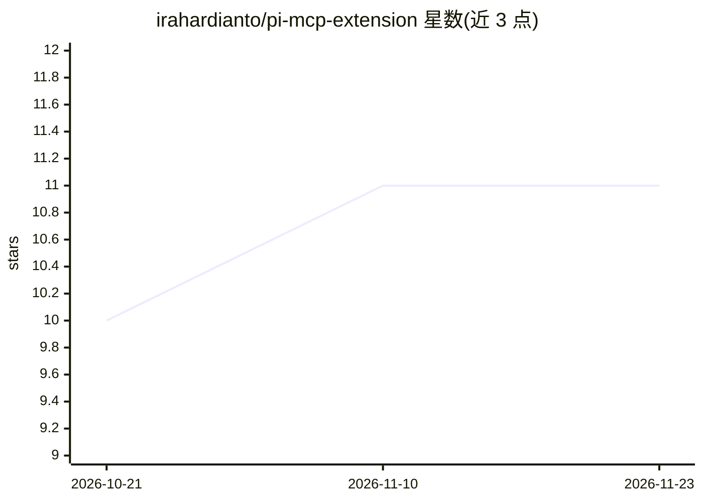

# irahardianto/pi-mcp-extension

⭐ 11 · TypeScript · MIT · 推送 2026-11-22 · [GitHub](https://github.com/irahardianto/pi-mcp-extension) · [官网](https://pi.dev/packages/pi-mcp-extension) · 个人维护

**为 Pi 编码代理接入任意 MCP 服务器的客户端扩展**

TypeScript 编写的 Model Context Protocol 客户端扩展，供 Pi coding agent 连接 MCP 服务器：管理服务器连接、发现工具并桥接给 LLM 调用。支持 stdio、streamable-http 与 sse 三种传输，含 OAuth 2.1（PKCE + 动态客户端注册）、eager/lazy 生命周期、自动重连与健康检查、工具名/顺序稳定化、脱敏调试日志。前提为 Node.js 22+ 与 Pi 编码代理，通过 pi install npm: 安装。

## 筛选速览

| 维度 | 判定 | 备注 |
|---|---|---|
| AI 角色 | `ai-ecosystem` | LLM/agent 周边工具 |
| 许可风险 | `permissive` | MIT |
| 部署形态 | `None` |  |
| 模型依赖 | — | README 未给出锁定关系 |
| 硬件要求 | — | 无带数字的原话,不猜 |
| 安装摩擦 | `low` | 无编译、无系统依赖或容器化 |
| 成熟度 | — | 结构信号不足 |

## 能力要点

- 多传输：stdio 子进程、streamable-http、legacy sse
- OAuth 2.1 授权（PKCE、DCR、浏览器与 headless/SSH 模式）
- 工具自动发现与 list_changed 热刷新，进度事件重置超时
- mcp_status/mcp_connect 等代理工具与 /mcp 系列命令

## 适用场景

- 让 Pi 编码代理连接 Supabase、Playwright、数据库等 MCP 服务器
- 通过 OAuth 2.1 接入需要授权的远程 MCP 服务
- 为不同项目配置不同的 MCP 服务器组合（受信任项目级覆盖）

## 场景标签

 · 领域:AI 开发工具/MCP 客户端

## 证据(README 行号)

> L12: **Connect Pi to any MCP server.** Supabase, DeepSource, Playwright, Context7, filesystem, databases — if it speaks 
> L14: `pi-mcp-extension` is a production-ready Model Context Protocol client extension for the Pi coding agent. It manage

## 星数曲线

2026-10-21 10 → 2026-11-23 11（+1）

---
*卡片 v1 · prompt 1.4 · 生成 2026-11-18 · 置信度 high · 依据 README sha `d6b03a7068d6` · [字段定义](../../DATASET.md)*
