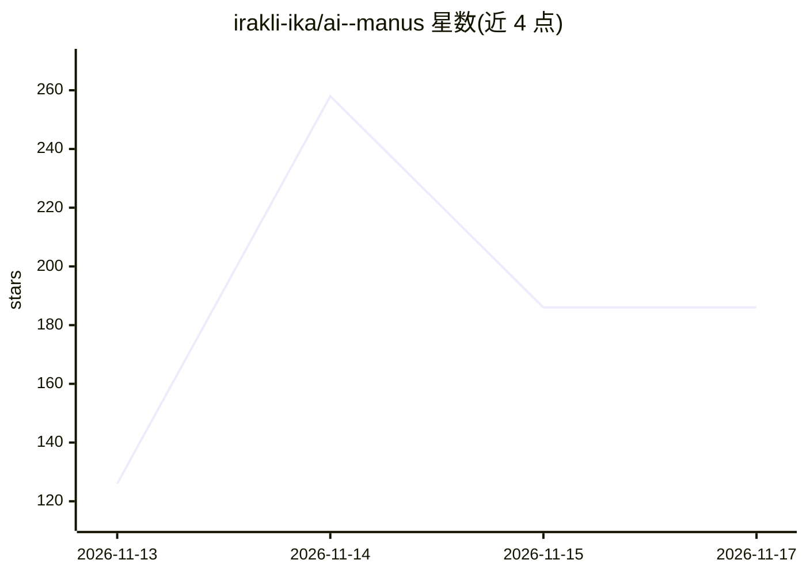

# irakli-ika/ai--manus

⭐ 186 · Apache-2.0 · 推送 2026-11-15 · [GitHub](https://github.com/irakli-ika/ai--manus) · 个人维护

**自主执行代码与浏览器操作的通用 AI Agent 系统**

面向家庭、学习与轻量办公场景的自主 AI agent：用户描述任务后，agent 自行编写并执行脚本、打开网页、填写表单、完成多步骤任务，代码执行与浏览器控制可在同一流程内衔接；也可作为后台个人助手处理重复性事务。README 提供兼容性表（最低 4GB 内存、双核 CPU）与使用步骤说明，但未给出安装命令、代码位置或接入的模型提供商等技术细节，仅以主题标签提及 openai/anthropic 等。README 呈营销文案风格，实质工程信息有限。

## 筛选速览

| 维度 | 判定 | 备注 |
|---|---|---|
| AI 角色 | `ai-native` | 本体是模型或模型工具 |
| 许可风险 | `permissive` | Apache-2.0 |
| 部署形态 | `None` |  |
| 模型依赖 | — | README 未给出锁定关系 |
| 硬件要求 | — | 无带数字的原话,不猜 |
| 安装摩擦 | `low` | 无编译、无系统依赖或容器化 |
| 成熟度 | — | 结构信号不足 |

## 能力要点

- 自主编写并执行代码完成任务
- 浏览器控制：导航网页、填表、收集信息
- 代码与浏览器操作可在同一工作流中衔接
- 面向小规模场景（学习、家庭、轻办公）

## 适用场景

- 让 agent 代为完成网页查资料、填表等重复操作
- 学习和研究中组织笔记、跑小脚本
- 多标签页信息汇总与轻量报告准备

## 场景标签

`AI 助手` `浏览器自动化` `编码 Agent` · 领域:效率与自动化

## 证据(README 行号)

> L18: Manus is an autonomous AI agent designed to run code and control a browser on your behalf. Instead of acting like a
> L10: - **Autonomous Code Execution:** Manus AI agent runs code on its own to complete tasks, so you can focus on decisio

## 星数曲线

2026-11-13 126 → 2026-11-17 186（+60）

---
*卡片 v1 · prompt 1.4 · 生成 2026-11-17 · 置信度 low · 依据 README sha `0f78ee3a5dd2` · [字段定义](../../DATASET.md)*
