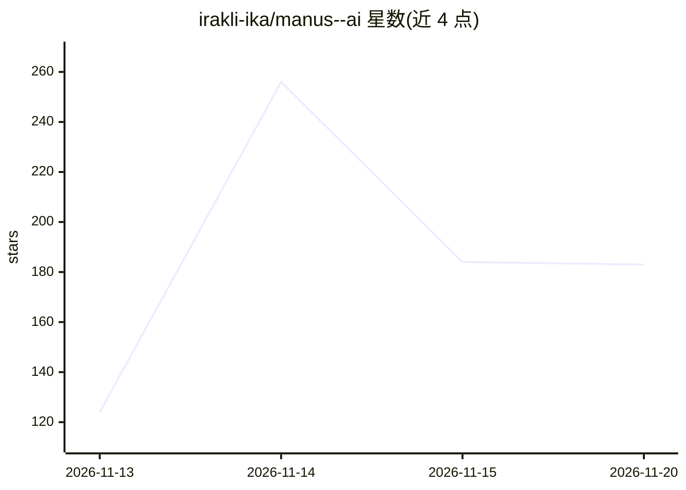

# irakli-ika/manus--ai

⭐ 183 · Apache-2.0 · 推送 2026-11-15 · [GitHub](https://github.com/irakli-ika/manus--ai) · 个人维护

**面向个人用户的自主 AI 代理：代写代码并控制浏览器**

README 描述的自主 AI 代理系统，声称可在沙箱环境运行工具与操作：自主编写并执行脚本、控制浏览器（导航网页、填表、收集信息）、执行多步骤日常任务，定位为家庭、学习与轻量办公场景的后台个人助理，非企业平台。给出兼容性表（最低 4GB RAM、双核 CPU）与上手步骤。但 README 未提供任何安装命令、代码仓库结构、模型接入方式或运行说明，实质内容以功能宣传和搜索关键词为主，可验证的技术细节有限。

## 筛选速览

| 维度 | 判定 | 备注 |
|---|---|---|
| AI 角色 | `ai-native` | 本体是模型或模型工具 |
| 许可风险 | `permissive` | Apache-2.0 |
| 部署形态 | `None` |  |
| 模型依赖 | — | README 未给出锁定关系 |
| 硬件要求 | — | 无带数字的原话,不猜 |
| 安装摩擦 | `low` | 无编译、无系统依赖或容器化 |
| 成熟度 | — | 结构信号不足 |

## 能力要点

- 自主编写并执行代码完成任务
- 浏览器控制：导航、填表、信息收集
- 跨会话的任务模式记忆与多步骤任务执行

## 适用场景

- 让代理代为执行重复的脚本与浏览器操作
- 学习与研究中收集资料、运行小脚本
- 轻量办公中多页面信息汇总

## 场景标签

`AI 助手` `编码 Agent` `浏览器自动化` · 领域:效率与自动化

## 证据(README 行号)

> L10: - **Autonomous Code Execution:** Manus AI agent runs code on its own to complete tasks, so you can focus on decisio
> L18: Manus is an autonomous AI agent designed to run code and control a browser on your behalf. Instead of acting like a

## 星数曲线

2026-11-13 124 → 2026-11-20 183（+59）

---
*卡片 v1 · prompt 1.4 · 生成 2026-11-17 · 置信度 low · 依据 README sha `a3d88e202bf0` · [字段定义](../../DATASET.md)*
