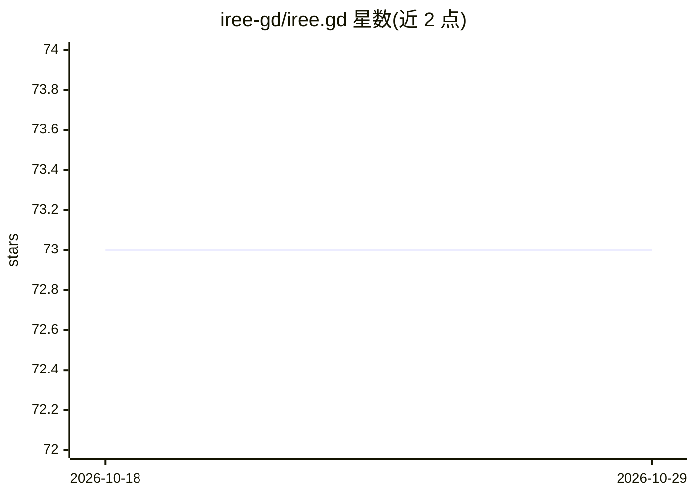

# iree-gd/iree.gd

⭐ 73 · C++ · MIT · 推送 2026-06-13 · [GitHub](https://github.com/iree-gd/iree.gd) · 个人维护

**在 Godot 中原生运行预训练机器学习模型的 IREE 运行时**

通过 GDExtension 将 IREE 运行时接入 Godot 引擎，使预训练机器学习模型（如 PyTorch 导出）可在 Godot 项目内原生运行。按平台自动选用 HAL 后端：Apple 产品用 metal，Windows/Linux/*BSD/Android 桌面与移动端用 vulkan，其余平台用 vmvx。面向 Godot 游戏与应用开发者，提供 GitHub Pages 文档与示例工程，需通过 Git 与 CMake 从源码构建，编译产物输出到示例插件目录。

## 筛选速览

| 维度 | 判定 | 备注 |
|---|---|---|
| AI 角色 | `ai-ecosystem` | LLM/agent 周边工具 |
| 许可风险 | `permissive` | MIT |
| 部署形态 | `None` |  |
| 模型依赖 | — | README 未给出锁定关系 |
| 硬件要求 | — | 无带数字的原话,不猜 |
| 安装摩擦 | `medium` | 含编译或系统依赖之一 |
| 成熟度 | — | 结构信号不足 |

## 能力要点

- 以 GDExtension 形式在 Godot 中嵌入 IREE 运行时
- 按平台选择 HAL 后端（metal/vulkan/vmvx）
- 可选用 CMake 选项从源码编译捆绑 LLVM
- 提供 GitHub Pages 文档与 sample 示例工程

## 适用场景

- 在 Godot 游戏或应用中运行预训练 ML 模型
- 跨 Apple/桌面/移动平台部署推理后端
- 参考示例工程学习 IREE.gd 集成方式

## 场景标签

`推理引擎` · 领域:训练与推理

## 证据(README 行号)

> L5: IREE runtime in Godot through GDExtension, a mission to run a machine learning model (e.g. PyTorch) natively in Godo

## 星数曲线

2026-10-18 73 → 2026-10-29 73（+0）

---
*卡片 v1 · prompt 1.4 · 生成 2026-10-24 · 置信度 high · 依据 README sha `5728d46eda48` · [字段定义](../../DATASET.md)*
