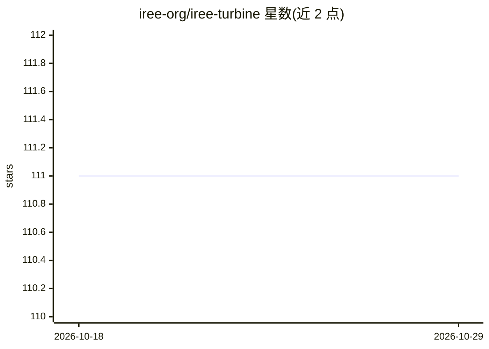

# iree-org/iree-turbine

⭐ 111 · Python · Apache-2.0 · 推送 2026-07-20 · [GitHub](https://github.com/iree-org/iree-turbine) · [官网](https://iree.dev/guides/ml-frameworks/pytorch/) · 组织维护

**IREE 的 PyTorch 前端：将 PyTorch 模型编译为部署产物**

IREE Turbine 是 IREE 编译器/运行时的 PyTorch 前端，基于 Torch Dynamo。提供三类工具：AOT Export 将一个或多个 nn.Module 编译为可部署产物（含简单一次性导出 API 与面向复杂模型的高级 API）；Eager Execution 提供 torch.compile 后端及 Turbine Tensor/Device 供交互式使用；Custom Ops 支持以 IREE 后端 IR 或 Python 风格内核语言定义自定义算子。面向使用 PyTorch 并希望经 IREE 部署模型的开发者，从 PyPI 安装。README 说明动态形状支持仍在进行中。

## 筛选速览

| 维度 | 判定 | 备注 |
|---|---|---|
| AI 角色 | `ai-ecosystem` | LLM/agent 周边工具 |
| 许可风险 | `permissive` | Apache-2.0 |
| 部署形态 | `library` | 以包/库形式分发 |
| 模型依赖 | — | README 未给出锁定关系 |
| 硬件要求 | — | 无带数字的原话,不猜 |
| 安装摩擦 | `low` | 无编译、无系统依赖或容器化 |
| 成熟度 | `idea` | |

## 能力要点

- AOT Export 将 nn.Module 编译为可部署产物
- 提供 torch.compile 后端与 Turbine Tensor/Device 交互式执行
- 支持以 IREE 后端 IR 或 Pythonic 内核语言定义自定义算子

## 适用场景

- 将 PyTorch 训练的模型编译为可部署产物
- 在 PyTorch 会话内通过 torch.compile 使用 IREE 后端执行
- 为 IREE 后端实现自定义算子

## 场景标签

`推理引擎` · 领域:训练与推理

## 证据(README 行号)

> L6: Turbine is IREE's frontend for
> L11: * *AOT Export*: For compiling one or more `nn.Module`s to compiled, deployment
> L18: * *Eager Execution*: A `torch.compile` backend is provided and a Turbine Tensor/Device

## 星数曲线

2026-10-18 111 → 2026-10-29 111（+0）

---
*卡片 v1 · prompt 1.4 · 生成 2026-10-23 · 置信度 high · 依据 README sha `921746fa07f6` · [字段定义](../../DATASET.md)*
