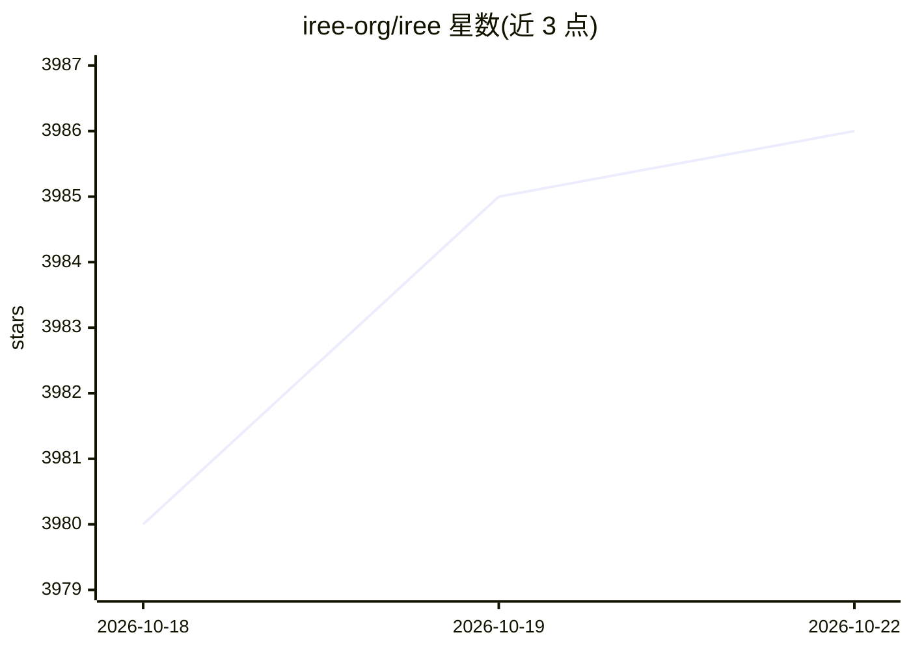

# iree-org/iree

⭐ 3,986 · C++ · Apache-2.0 · 推送 2026-10-21 · [GitHub](https://github.com/iree-org/iree) · [官网](http://iree.dev/) · 组织维护

**MLIR 编译器与运行时：将 ML 模型编译到多类硬件部署**

基于 MLIR 的端到端机器学习编译器和运行时工具包：将 ML 模型降低到统一 IR，支持从数据中心到移动和边缘设备的部署。项目已加入 LF AI & Data Foundation（sandbox 阶段），通过 PyPI 发布 iree-base-compiler 与 iree-base-runtime 包，提供 GitHub stable/nightly 发布及 Linux/macOS 的 CI 构建，源码构建指引见官方网站。采用 Apache 2.0（含 LLVM Exceptions）许可。

## 筛选速览

| 维度 | 判定 | 备注 |
|---|---|---|
| AI 角色 | `ai-ecosystem` | LLM/agent 周边工具 |
| 许可风险 | `permissive` | Apache-2.0 |
| 部署形态 | `library` | 以包/库形式分发 |
| 模型依赖 | — | README 未给出锁定关系 |
| 硬件要求 | — | 无带数字的原话,不猜 |
| 安装摩擦 | `low` | 无编译、无系统依赖或容器化 |
| 成熟度 | — | 结构信号不足 |

## 能力要点

- MLIR 端到端编译与运行时，模型降低到统一 IR
- 覆盖数据中心到移动/边缘的部署范围
- PyPI 发布 compiler 与 runtime 包，另有 stable/nightly 发布渠道

## 适用场景

- 把训练好的 ML 模型编译部署到 GPU/移动/边缘等多种目标硬件
- 通过 Python 包使用编译器与运行时组件
- 参与或跟踪 MLIR 生态的编译器开发

## 场景标签

`推理引擎` · 领域:训练与推理

## 证据(README 行号)

> L4: pronounced as "eerie") is an MLIR-based end-to-end
> L5: compiler and runtime that lowers Machine Learning (ML) models to a unified IR

## 星数曲线

2026-10-18 3,980 → 2026-10-22 3,986（+6）

---
*卡片 v1 · prompt 1.4 · 生成 2026-10-20 · 置信度 high · 依据 README sha `a2f6693985c0` · [字段定义](../../DATASET.md)*
