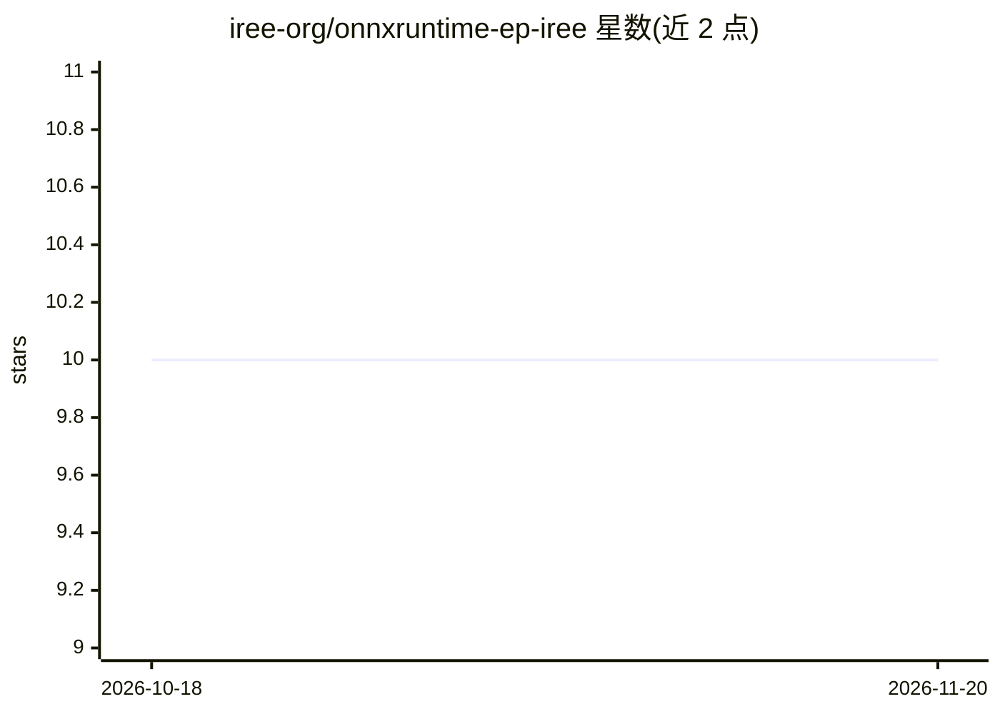

# iree-org/onnxruntime-ep-iree

⭐ 10 · C++ · Apache-2.0 · 推送 2026-05-15 · [GitHub](https://github.com/iree-org/onnxruntime-ep-iree) · 组织维护

**为 ONNX Runtime 提供基于 IREE 的执行后端**

以 ONNX Runtime Execution Provider 形式接入 IREE 编译/运行时：Python 包安装后产出共享库供 ONNX Runtime 加载，通过 SessionOptions 配置目标架构（cuda/hip/vulkan/cpu）、编译优化等级、维度特化约束与中间产物保存等选项；构建过程运行 CMake 并拉取固定版本的 ONNX Runtime 与 IREE 源码，另提供 dev_me.py 开发者可编辑安装流程与 Tracy 追踪变体。面向需要在 ONNX Runtime 中使用 IREE 后端的机器学习开发者。

## 筛选速览

| 维度 | 判定 | 备注 |
|---|---|---|
| AI 角色 | `ai-ecosystem` | LLM/agent 周边工具 |
| 许可风险 | `permissive` | Apache-2.0 |
| 部署形态 | `library` | 以包/库形式分发 |
| 模型依赖 | — | README 未给出锁定关系 |
| 硬件要求 | — | 无带数字的原话,不猜 |
| 安装摩擦 | `high` | 编译与系统依赖俱全 |
| 成熟度 | — | 结构信号不足 |

## 能力要点

- 以 ONNX Runtime Execution Provider 形式提供 IREE 编译/运行能力
- 支持 cuda/hip/vulkan/cpu 后端并配置优化等级与维度特化
- 提供 Tracy 追踪变体与中间产物（MLIR/VMFB/IRPA）保存调试
- 支持 pip 安装与 dev_me.py 可编辑开发流程，也可纯 CMake 构建共享库

## 适用场景

- 在 ONNX Runtime 会话中把模型执行调度到 IREE 后端
- 针对 GPU（CUDA/HIP/Vulkan）目标编译并运行 ONNX 模型
- 对 EP 编译过程做追踪与中间产物调试

## 场景标签

`推理引擎` · 领域:训练与推理

## 证据(README 行号)

> L3: IREE based ONNX Runtime Execution Provider.
> L56: The Python provider option names are stored internally as ONNX Runtime session

## 星数曲线

2026-10-18 10 → 2026-11-20 10（+0）

---
*卡片 v1 · prompt 1.4 · 生成 2026-11-19 · 置信度 high · 依据 README sha `2b25456cc650` · [字段定义](../../DATASET.md)*
