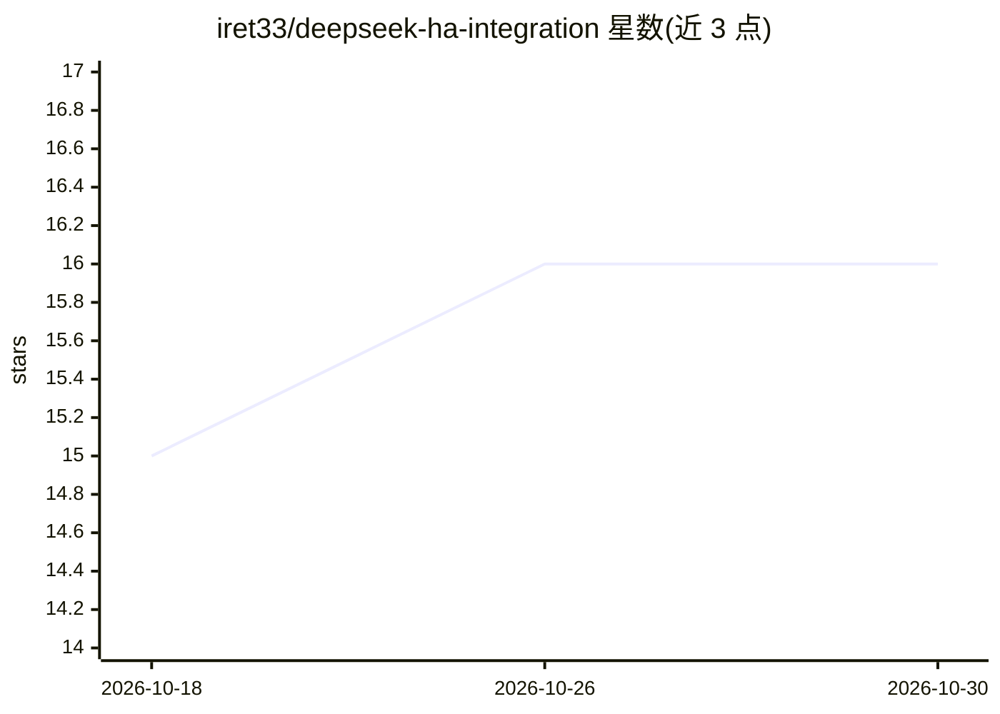

# iret33/deepseek-ha-integration

⭐ 16 · Python · MIT · 推送 2026-09-24 · [GitHub](https://github.com/iret33/deepseek-ha-integration) · 个人维护

**将 DeepSeek API 接入 Home Assistant 的社区集成**

面向 Home Assistant 用户的自定义集成：把 DeepSeek 的 OpenAI 兼容 API 接入智能家居，注册对话代理（可用于语音指令与聊天界面）和 deepseek.generate 服务，并注册 AI Task 实体以在可视化自动化中调用。支持 deepseek-v4-flash / deepseek-v4-pro 两款模型与可选思考模式（High/Max），结构化任务通过 response_format 返回 JSON。经 HACS 或手动复制文件安装，UI 配置流填写 API key，对话数据发送至 DeepSeek 云端、本地不存储。

## 筛选速览

| 维度 | 判定 | 备注 |
|---|---|---|
| AI 角色 | `ai-ecosystem` | LLM/agent 周边工具 |
| 许可风险 | `permissive` | MIT |
| 部署形态 | `None` |  |
| 模型依赖 | locked-api |  |
| 硬件要求 | — | 无带数字的原话,不猜 |
| 安装摩擦 | `low` | 无编译、无系统依赖或容器化 |
| 成熟度 | — | 结构信号不足 |

## 能力要点

- 注册对话代理与 deepseek.generate 服务、AI Task 实体
- 支持 deepseek-v4-flash / deepseek-v4-pro 与思考模式（High/Max）
- 结构化任务自动设置 response_format=json_object 并返回 dict
- HACS 安装 + UI 配置流，无需 YAML

## 适用场景

- 在 Home Assistant 中把 DeepSeek 用作语音/聊天助手
- 自动化中调用 DeepSeek 生成天气摘要等文本或 JSON
- 为智能家居设备状态更新生成自然语言描述

## 场景标签

`AI 助手` `工作流自动化` · 领域:效率与自动化

## 证据(README 行号)

> L6: A community Home Assistant integration that brings the DeepSeek API to your smart home — conversation agent plus a `
> L10: - **🤖 Conversation Agent**: Use DeepSeek as your Home Assistant voice/chat assistant

## 星数曲线

2026-10-18 15 → 2026-10-30 16（+1）

---
*卡片 v1 · prompt 1.4 · 生成 2026-10-30 · 置信度 high · 依据 README sha `e846ce784ee2` · [字段定义](../../DATASET.md)*
