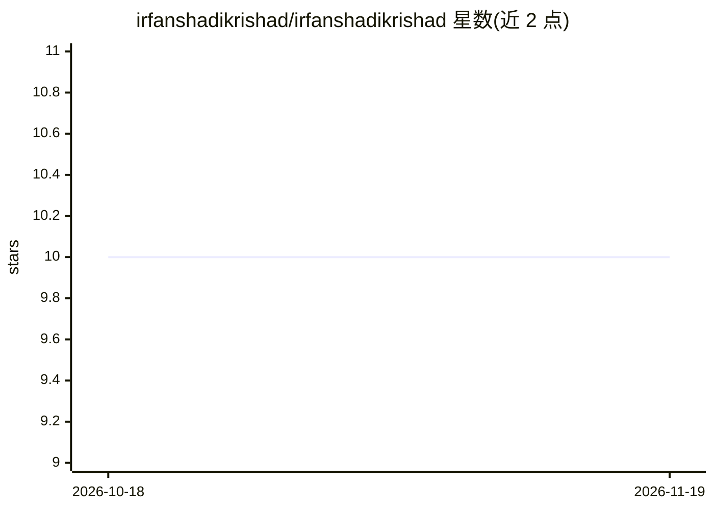

# irfanshadikrishad/irfanshadikrishad

⭐ 10 · Shell · 推送 2026-11-18 · [GitHub](https://github.com/irfanshadikrishad/irfanshadikrishad) · [官网](https://github.com/irfanshadikrishad) · 个人维护

**个人 GitHub 主页 README（个人资料配置仓库）**

该仓库为个人 GitHub 资料页配置仓库，可见内容为语言使用时长统计（WakaTime 风格条形图，含 JavaScript/JSON/HTML/Bash/YAML 占比）。仓库主题标签涉及 config、readme-profile、machine-learning、mern-stack 等，但 README 可见部分仅展示编码时长统计，未提供工具、安装步骤或功能说明，用途为展示个人编码活动。

## 筛选速览

| 维度 | 判定 | 备注 |
|---|---|---|
| AI 角色 | `ai-knowledge` | 知识聚合/清单类 |
| 许可风险 | `none` | — |
| 部署形态 | `None` |  |
| 模型依赖 | — | README 未给出锁定关系 |
| 硬件要求 | — | 无带数字的原话,不猜 |
| 安装摩擦 | `low` | 无编译、无系统依赖或容器化 |
| 成熟度 | — | 结构信号不足 |

## 能力要点

- 展示各语言编码时长与占比统计条形图
- 个人 GitHub 主页 README 配置

## 适用场景

- 在个人 GitHub 主页展示编码活动统计

## 场景标签

 · 领域:开发者个人主页/配置

## 证据(README 行号)

> L2: Javascript     0h 38m  █████████░░░░░░░░░░░░░░░░░░░░░░░░░░░░░░░░░░░░░░░░░   18.1%
> L3: Json           0h 30m  ███████░░░░░░░░░░░░░░░░░░░░░░░░░░░░░░░░░░░░░░░░░░░   14.2%

## 星数曲线

2026-10-18 10 → 2026-11-19 10（+0）

---
*卡片 v1 · prompt 1.4 · 生成 2026-11-19 · 置信度 low · 依据 README sha `2321c86eea0c` · [字段定义](../../DATASET.md)*
