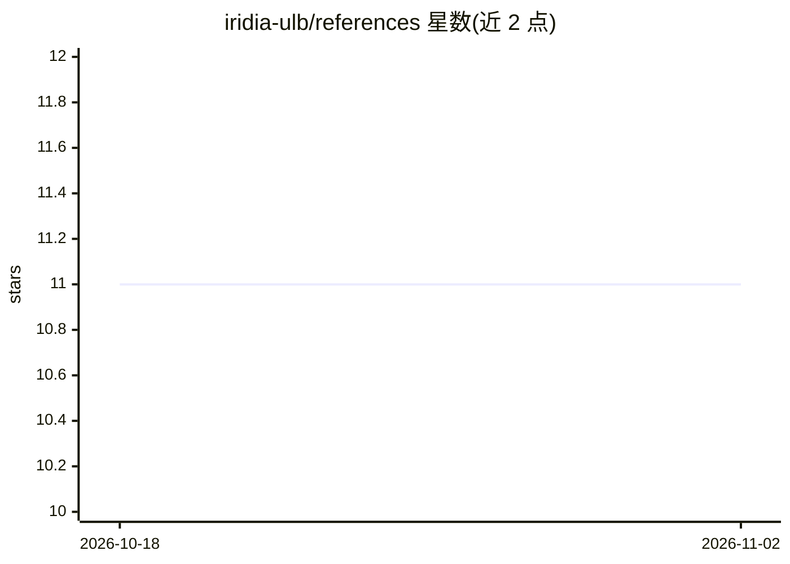

# iridia-ulb/references

⭐ 11 · TeX · 推送 2026-10-29 · [GitHub](https://github.com/iridia-ulb/references) · [官网](https://iridia-ulb.github.io/references/) · 组织维护

**IRIDIA 实验室共享的 BibTeX 参考文献库：供论文引用**

布鲁塞尔自由大学 IRIDIA 实验室维护的共享 BibTeX 文件集合，按 articles/biblio/crossref/authors/journals/abbrev 等文件分类组织条目以避免冗余，并规定条目键名构造规则（作者姓氏前三字母+年份+出版物缩写）。使用方式是将仓库克隆或链接到论文目录，通过 \bibliography 命令引入，提供符号链接、fake submodule、worktree 三种接入方法；覆盖机器学习、元启发式与优化领域文献，主题为机器学习/优化。

## 筛选速览

| 维度 | 判定 | 备注 |
|---|---|---|
| AI 角色 | `ai-knowledge` | 知识聚合/清单类 |
| 许可风险 | `none` | — |
| 部署形态 | `None` |  |
| 模型依赖 | — | README 未给出锁定关系 |
| 硬件要求 | — | 无带数字的原话,不猜 |
| 安装摩擦 | `low` | 无编译、无系统依赖或容器化 |
| 成熟度 | — | 结构信号不足 |

## 能力要点

- 按条目类型分文件组织，避免冗余并支持命令覆盖自定义
- 规定统一的 BibTeX 键名构造规则（作者+年份+出版物缩写）
- 提供符号链接 / fake submodule / git worktree 三种接入方法
- 配套 aux2bib 程序可从 aux 生成单一 BibTeX 文件

## 适用场景

- 写论文时直接引入共享参考文献库，避免各论文重复维护
- 团队协作用同一参考文献库并同步更新
- 提交论文前用 aux2bib 合并生成单个 bib 文件

## 场景标签

 · 领域:学术写作/文献管理

## 证据(README 行号)

> L10: This is a collection of BibTeX files organized in a way that tries to avoid redundancy, minimise mistakes and facil
> L25:  * `articles.bib`: Only `@Article` entries.
> L87: The IRIDIA BibTex repository is essentially a collection of `.bib` files, so

## 星数曲线

2026-10-18 11 → 2026-11-02 11（+0）

---
*卡片 v1 · prompt 1.4 · 生成 2026-11-02 · 置信度 high · 依据 README sha `4f5bd5818d5e` · [字段定义](../../DATASET.md)*
