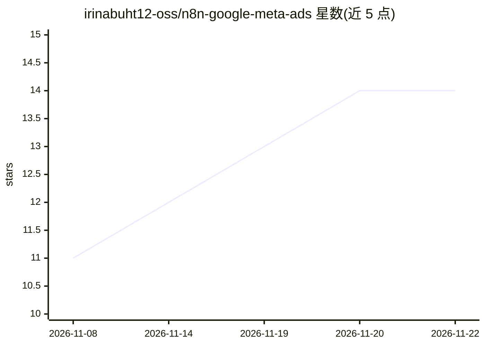

# irinabuht12-oss/n8n-google-meta-ads

⭐ 14 · 推送 2026-09-09 · [GitHub](https://github.com/irinabuht12-oss/n8n-google-meta-ads) · [官网](https://www.get-ryze.ai/how-to-connect-claude-to-google-meta-ads-mcp) · 组织维护

**在 n8n 中通过 Ryze MCP 让 AI agent 读取并操作 Google/Meta 广告账户**

两个可导入的 n8n 工作流：其一由 Gemini 驱动的 AI agent 经 Ryze MCP 拉取 Google Ads 与 Meta Ads 表现数据，调用 Gamma API 生成演示文稿并通过 Gmail 发送；其二由表单触发，Firecrawl 抓取品牌站点后用 Gemini 生成品牌指南文档，再用 Nano Banana 从参考图生成静态广告变体。凭 Ryze connector 免去 Google Ads developer token 与 Meta app 审核，OAuth 授权账户即可；连接端点也可在 Claude Code、claude.ai、ChatGPT、Cursor 中使用。

## 筛选速览

| 维度 | 判定 | 备注 |
|---|---|---|
| AI 角色 | `ai-native` | 本体是模型或模型工具 |
| 许可风险 | `none` | — |
| 部署形态 | `None` |  |
| 模型依赖 | — | README 未给出锁定关系 |
| 硬件要求 | — | 无带数字的原话,不猜 |
| 安装摩擦 | `low` | 无编译、无系统依赖或容器化 |
| 成熟度 | — | 结构信号不足 |

## 能力要点

- 经 Ryze MCP 连接 Google Ads 与 Meta Ads，无需 developer token 或 Meta app 审核
- 工作流一：对话触发审计，agent 拉取广告数据并经 Gamma 生成幻灯片邮件
- 工作流二：Firecrawl 抓站 + Gemini 品牌指南 + Nano Banana 生成静态广告变体
- 同一 MCP 端点可在 Claude Code、claude.ai、ChatGPT、Cursor 中接入

## 适用场景

- 让 AI agent 读取真实广告账户的报表与搜索词数据
- 一句话生成上周广告审计的幻灯片并邮件发送
- 从品牌站点抓取信息批量生成静态广告素材

## 场景标签

`工作流自动化` `图像生成` · 领域:效率与自动化

## 证据(README 行号)

> L5: Two importable n8n workflows that put an AI agent on top of your real Google Ads and Meta Ads accounts through the R
> L19: |`clawdbot-n8n-google-meta.json`|**AI Agent - MCP Data + Gamma Report.** Chat trigger → AI agent (Gemini) with the 

## 星数曲线

2026-11-08 11 → 2026-11-22 14（+3）

---
*卡片 v1 · prompt 1.4 · 生成 2026-11-18 · 置信度 high · 依据 README sha `41871499a768` · [字段定义](../../DATASET.md)*
