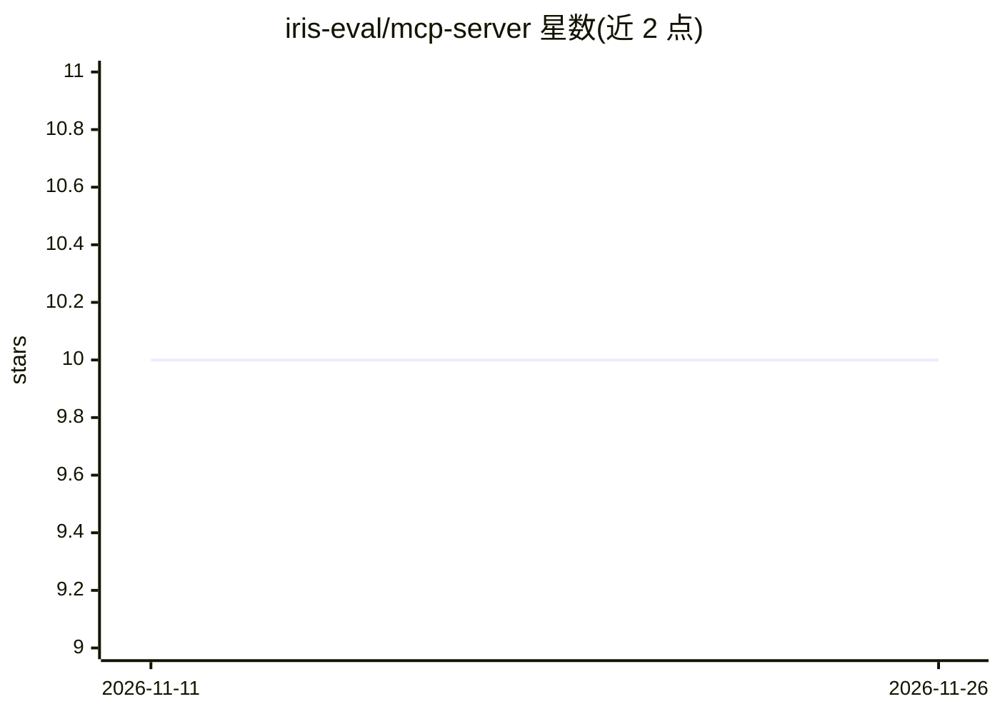

# iris-eval/mcp-server

⭐ 10 · TypeScript · MIT · 推送 2026-11-23 · [GitHub](https://github.com/iris-eval/mcp-server) · [官网](https://iris-eval.com) · 组织维护

**给 agent 输出打质量/安全/成本分的本地评估 MCP 服务器**

一个运行在本机的 MCP 服务器加仪表盘：接收 agent 运行轨迹存入本地 SQLite，用 28 条内置确定性规则评分（PII、提示注入、幻觉标记、成本阈值、工具调用），可选 LLM judge 处理语义问题且设单次成本上限。支持 12 个 MCP 工具、HTTP 摄取端点、Python/JS SDK 包装 OpenAI/Anthropic 客户端与 LangChain 回调、CI 门禁与 GitHub Action。需 Node.js 22.13+，无遥测，MIT 许可。

## 筛选速览

| 维度 | 判定 | 备注 |
|---|---|---|
| AI 角色 | `ai-ecosystem` | LLM/agent 周边工具 |
| 许可风险 | `permissive` | MIT |
| 部署形态 | `self-host` | docker 或自建部署 |
| 模型依赖 | — | README 未给出锁定关系 |
| 硬件要求 | — | 无带数字的原话,不猜 |
| 安装摩擦 | `low` | 无编译、无系统依赖或容器化 |
| 成熟度 | — | 结构信号不足 |

## 能力要点

- 28 条可审计可编辑的确定性评分规则，无 LLM 调用即可运行
- 一条命令为 10 种 MCP 客户端写入配置并安装
- HTTP 摄取端点与 SDK 包装器实现不依赖模型决策的捕获
- CI 门禁与 GitHub Action 按判定结果失败构建

## 适用场景

- 在仪表盘上查看 agent 失败案例及其证据
- 在 CI 中对 agent 轨迹评分不达标即失败
- 记录并评估每次 Claude Code 对话回合
- 通过包装 OpenAI/Anthropic 客户端为每次模型调用生成评分轨迹

## 场景标签

`LLM 可观测性` `模型评测` · 领域:评测与运维

## 证据(README 行号)

> L11: **Send Iris an agent run and ask for a verdict on its quality, safety, and cost — on your machine, with no SDK and 
> L53: It runs in any MCP client, and every client it names has a row saying how it is checked. **Verified on every CI run

## 星数曲线

2026-11-11 10 → 2026-11-26 10（+0）

---
*卡片 v1 · prompt 1.4 · 生成 2026-11-19 · 置信度 mid · 依据 README sha `11fe3450c471` · [字段定义](../../DATASET.md)*
