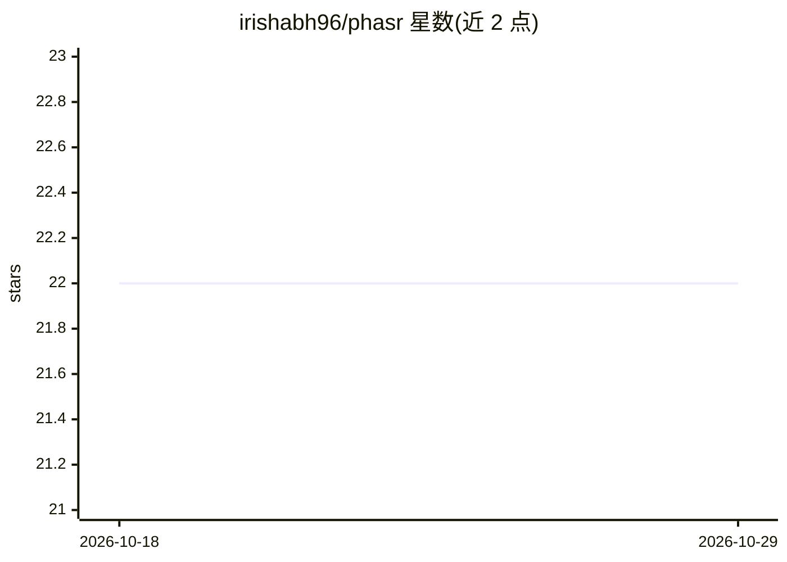

# irishabh96/phasr

⭐ 22 · TypeScript · MIT · 推送 2026-10-20 · [GitHub](https://github.com/irishabh96/phasr) · [官网](https://phasr.sh) · 个人维护

**并行运行多个编码 agent 的 macOS 桌面工作台**

基于 Tauri 2 的桌面应用，用于编排并发编码 agent 会话（Claude Code、Codex、Copilot、Gemini、OpenCode），每个工作区使用独立 git worktree 隔离，提供实时终端流输出与集成 git 工作流。要求一个或多个 agent CLI 位于 PATH 上，运行时需登录（Clerk + Supabase 云元数据同步为必需）。当前为 pre-1.0，仅支持 macOS Apple Silicon，构建未签名，需通过 xattr 命令绕过 Gatekeeper 首次启动。

## 筛选速览

| 维度 | 判定 | 备注 |
|---|---|---|
| AI 角色 | `ai-ecosystem` | LLM/agent 周边工具 |
| 许可风险 | `permissive` | MIT |
| 部署形态 | `desktop` | 安装包/桌面程序 |
| 模型依赖 | — | README 未给出锁定关系 |
| 硬件要求 | — | 无带数字的原话,不猜 |
| 安装摩擦 | `low` | 无编译、无系统依赖或容器化 |
| 成熟度 | `idea` | |

## 能力要点

- 每个 agent 会话运行在独立的 git worktree 中实现隔离
- 支持 Claude Code、Codex、Copilot、Gemini、OpenCode 等 agent CLI 并可在设置中添加/编辑
- 实时终端流输出（ghostty-web WebAssembly + Rust PTY）
- 本地 SQLite 存储与 Clerk/Supabase 登录云同步

## 适用场景

- 同时在多个任务上并行运行编码 agent 而不互相干扰
- 在一个桌面界面中管理多种 agent CLI 的会话与终端输出
- 结合 git worktree 隔离地审查和合并各 agent 的改动

## 场景标签

`编码 Agent` · 领域:编码与开发

## 证据(README 行号)

> L5: Phasr is a desktop app that orchestrates concurrent coding-agent sessions
> L6: — Claude, Codex, Copilot, Gemini, OpenCode — with per-workspace git
> L33: - One or more agent CLIs on your `PATH`. Phasr launches whichever one you choose per workspace.

## 星数曲线

2026-10-18 22 → 2026-10-29 22（+0）

---
*卡片 v1 · prompt 1.4 · 生成 2026-10-27 · 置信度 mid · 依据 README sha `48d497a22c24` · [字段定义](../../DATASET.md)*
