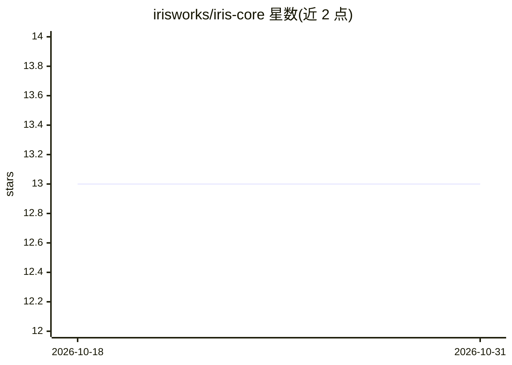

# irisworks/iris-core

⭐ 13 · TypeScript · Apache-2.0 · 推送 2026-10-30 · [GitHub](https://github.com/irisworks/iris-core) · [官网](https://irisflow.dev) · 组织维护

**自托管 Slack/Telegram AI agent：运行时自我扩展技能与子agent**

可自托管的 AI 操作型 agent：通过 Slack、Telegram 或内置 Web UI 对话下达任务，它执行命令、在运行时编写并热重载自己的技能（SKILL.md 目录+脚本）、按需生成子 agent 队列（Docker 或 Firecracker microVM 隔离，含 KVM 硬件边界/jailer/seccomp 多层防护）。支持 Anthropic、OpenAI、Azure AI Foundry、AWS Bedrock 多供应商切换，MCP 服务器经 meta/mcp.json 热加载接入，GitHub 作为技能长期记忆源。一条 curl|bash 命令在 Ubuntu 22.04 上以 systemd 服务方式安装。限制：面向 Linux 服务器自托管，Firecracker/KVM 与 Azure Key Vault 为可选加固项。

## 筛选速览

| 维度 | 判定 | 备注 |
|---|---|---|
| AI 角色 | `ai-native` | 本体是模型或模型工具 |
| 许可风险 | `permissive` | Apache-2.0 |
| 部署形态 | `library` | 以包/库形式分发 |
| 模型依赖 | locked-api |  |
| 硬件要求 | — | 无带数字的原话,不猜 |
| 安装摩擦 | `low` | 无编译、无系统依赖或容器化 |
| 成熟度 | — | 结构信号不足 |

## 能力要点

- 运行时自写技能并热重载，无需重新部署
- 子 agent 队列：Docker 默认，可选 Firecracker microVM（KVM+jailer+seccomp）隔离
- Slack/Telegram/Web UI 三种传输通道共用一个引擎，通道行为按 channels.json 五种模式配置
- MCP 服务器热加载接入，LLM 供应商经环境变量切换

## 适用场景

- 在 Slack/Telegram 里让 AI 队友执行命令、处理文件与自动化任务
- 运维场景中让 agent 自扩展现场技能并提交回私有 GitHub 仓库沉淀
- 需要强隔离的多人/多频道 agent 服务，每频道独立 microVM

## 场景标签

`Agent 框架` `多智能体` · 领域:Agent 开发

## 证据(README 行号)

> L3: **An AI operator that never clocks out.** Message it on Slack, Telegram, or its
> L17: - **Self-extending** — Iris writes and hot-reloads her own skills; no redeploy to teach her something new
> L20: - **Provider-agnostic** — Anthropic, OpenAI, Azure AI Foundry, or AWS Bedrock, switchable via env vars

## 星数曲线

2026-10-18 13 → 2026-10-31 13（+0）

---
*卡片 v1 · prompt 1.4 · 生成 2026-10-31 · 置信度 mid · 依据 README sha `2c6bef05c62e` · [字段定义](../../DATASET.md)*
