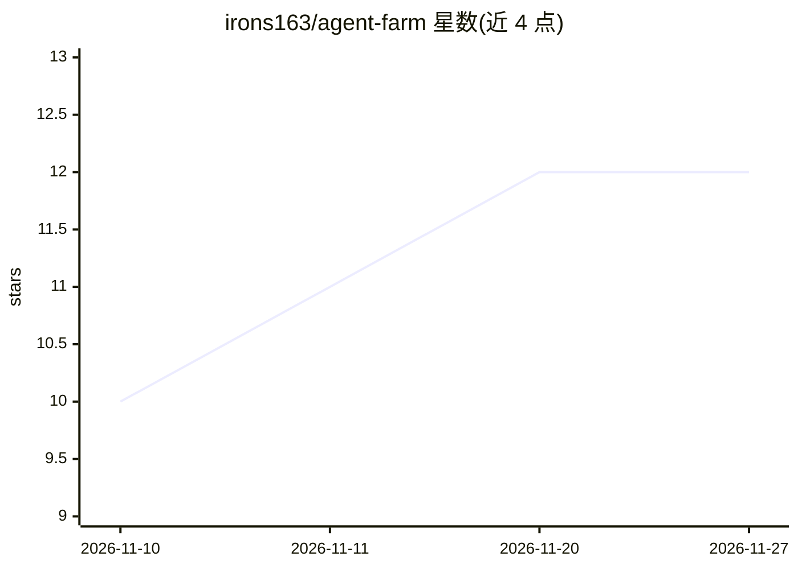

# irons163/agent-farm

⭐ 12 · JavaScript · MIT · 推送 2026-11-25 · [GitHub](https://github.com/irons163/agent-farm) · 个人维护 · 中文 README

**把本机 AI agent 显示为农场动物的可视化状态面板**

以 Blender 渲染美术素材构建的 2.5D 等角农场网页面板：只读各 AI agent 工具的本机会话记录（或接收 HTTP 上报），把每个工作阶段显示为一只动物，按工作/思考/等待回复/出错/待命/休眠六种状态呈现，等待授权时发桌面通知。提供 macOS/Windows/Linux 安装包，也可 Node.js 20+ 从源码运行；默认仅监听 127.0.0.1，不写记录、不上传数据，开放给其他设备需设置 token。

## 筛选速览

| 维度 | 判定 | 备注 |
|---|---|---|
| AI 角色 | `ai-ecosystem` | LLM/agent 周边工具 |
| 许可风险 | `permissive` | MIT |
| 部署形态 | `desktop` | 安装包/桌面程序 |
| 模型依赖 | local-ok | 支持本地模型 |
| 硬件要求 | — | 无带数字的原话,不猜 |
| 安装摩擦 | `low` | 无编译、无系统依赖或容器化 |
| 成熟度 | — | 结构信号不足 |

## 能力要点

- 自动侦测 Claude Code、Codex、Cursor、Gemini CLI、OpenCode 等平台的本机记录
- 任何程序可通过 POST /api/report 上报状态接入农场
- 农场动物映射六种 agent 状态，最多显示 12 只
- 预渲染美术资源，无需 npm install 或 Blender 即可用安装包运行

## 适用场景

- 同时跑多个 coding agent 时一眼查看谁在工作谁在等我回复
- agent 请求授权或出错时通过桌面通知及时处理
- 在手机或局域网其他设备上查看本机 agent 运行状态

## 场景标签

 · 领域:开发工具/agent 状态可视化

## 证据(README 行号)

> L5: 一座用 **Blender 算圖**的 2.5D 等角農場：電腦上每個 AI agent 都是一隻農場動物。誰在工作、誰在思考、誰在等你回覆，看一眼就知道。
> L67: |平台|從哪裡讀（唯讀）|狀態|
> L82: OpenAI Agents SDK、LangGraph、AutoGen、DeepSeek、你自己的機器人……任何程式都能回報狀態：

## 星数曲线

2026-11-10 10 → 2026-11-27 12（+2）

---
*卡片 v1 · prompt 1.4 · 生成 2026-11-18 · 置信度 high · 依据 README sha `c5c863929748` · [字段定义](../../DATASET.md)*
