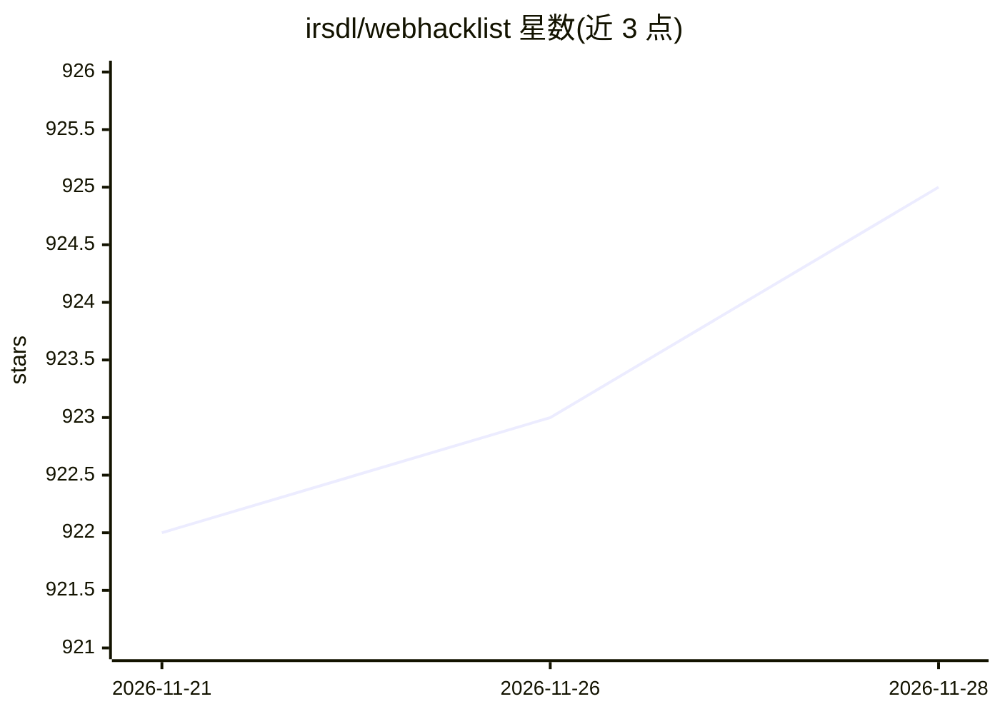

# irsdl/webhacklist

⭐ 925 · Python · MIT · 推送 2026-11-27 · [GitHub](https://github.com/irsdl/webhacklist) · [官网](https://webhacklist.com/) · 个人维护

**面向安全研究者：2006 年以来 Top 10 Web 黑客技术研究存档**

独立维护的 Web 黑客研究存档：完整保存 2006 年以来 PortSwigger 官方 Top 10 Web Hacking Techniques 的全部提名与获奖记录，另有官方轮次之外补充收录的研究、公告页 PDF 快照、原文 Markdown/PDF 副本、英文翻译及 Wayback 恢复记录。按年度 Markdown 文件组织（19 个年度合集共 1,783 条记录），官方提名与补充研究分节展示，AI 收集的暂定条目单独标注不参与排名。支持克隆仓库离线检索，托管网站需联网访问。

## 筛选速览

| 维度 | 判定 | 备注 |
|---|---|---|
| AI 角色 | `ai-knowledge` | 知识聚合/清单类 |
| 许可风险 | `permissive` | MIT |
| 部署形态 | `None` |  |
| 模型依赖 | — | README 未给出锁定关系 |
| 硬件要求 | — | 无带数字的原话,不猜 |
| 安装摩擦 | `low` | 无编译、无系统依赖或容器化 |
| 成熟度 | — | 结构信号不足 |

## 能力要点

- 保存 2006 年以来全部官方提名与获奖记录（1,136 条）及补充研究（647 条）
- 公告页 PDF 快照带可复现捕获工具与来源记录
- 通过 Wayback Machine 恢复失效文章并保留恢复出处
- 提供可用英文翻译与原文并列展示

## 适用场景

- 按年份检索历年 Top 10 Web 黑客技术及原文链接
- 离线查阅已保存的研究文章 Markdown/PDF 副本
- 查证某项技术当年的提名与排名原始记录

## 场景标签

`网络安全` `精选清单` · 领域:学习与行业

## 证据(README 行号)

> L10: **WebHackList — Web hacking research lists and archive. An independent archive of web hacking research — all offici
> L55: - **One Markdown file per annual collection**, including the combined **2016/17**
> L95: ├── <year>-ai.md              ← preliminary AI-collected research — unranked, not community-vetted, kept separate f

## 星数曲线

2026-11-21 922 → 2026-11-28 925（+3）

---
*卡片 v1 · prompt 1.4 · 生成 2026-11-28 · 置信度 high · 依据 README sha `6e82dd3de5e1` · [字段定义](../../DATASET.md)*
