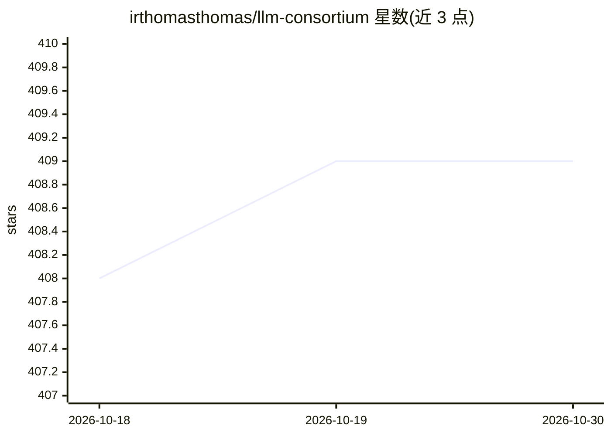

# irthomasthomas/llm-consortium

⭐ 409 · Python · Apache-2.0 · 推送 2026-09-05 · [GitHub](https://github.com/irthomasthomas/llm-consortium) · 个人维护

**编排多 LLM 并行推理、迭代共识与仲裁合成的 llm 插件**

面向 `llm` CLI 的 Python 插件：将同一提示并行发给多个模型（可按 model:count 指定实例数），收集响应后由指定仲裁模型按合成/排名/思维链排名三种评判方式综合答案，迭代精炼直至达到置信度阈值。提供语义共识过滤（响应嵌入聚类取最密区域）、几何置信度记录、SQLite 日志、嵌入可视化；支持保存命名配置并作为 `llm -m` 模型调用、会话续聊；另有 create_consortium 编程接口与本地 Studio 面板。README 注明几何置信度衡量响应形态一致性而非事实正确性。

## 筛选速览

| 维度 | 判定 | 备注 |
|---|---|---|
| AI 角色 | `ai-ecosystem` | LLM/agent 周边工具 |
| 许可风险 | `permissive` | Apache-2.0 |
| 部署形态 | `library` | 以包/库形式分发 |
| 模型依赖 | — | README 未给出锁定关系 |
| 硬件要求 | — | 无带数字的原话,不猜 |
| 安装摩擦 | `medium` | 含编译或系统依赖之一 |
| 成熟度 | — | 结构信号不足 |

## 能力要点

- 多模型并行编排 + 仲裁模型合成，迭代至置信度阈值
- 语义共识过滤：响应嵌入聚类取最密语义区域
- 三种评判方式：default 合成 / rank 排名 / rank-cot 思维链排名
- SQLite 日志、嵌入 HTML 可视化与本地 Studio 面板

## 适用场景

- 对复杂问题同时询问多个模型并让仲裁模型收敛出共识答案
- 按 model:count 配置多实例模型组合做并行推理
- 在 llm CLI 工作流中保存并复用命名 consortium 配置

## 场景标签

`模型网关` · 领域:Agent 开发

## 证据(README 行号)

> L9: This plugin for the `llm` package implements a model consortium system with iterative refinement and response synthe
> L22: - **Multi-Model Orchestration**: Coordinate responses from multiple models in parallel.

## 星数曲线

2026-10-18 408 → 2026-10-30 409（+1）

---
*卡片 v1 · prompt 1.4 · 生成 2026-10-21 · 置信度 mid · 依据 README sha `710a7460c49f` · [字段定义](../../DATASET.md)*
