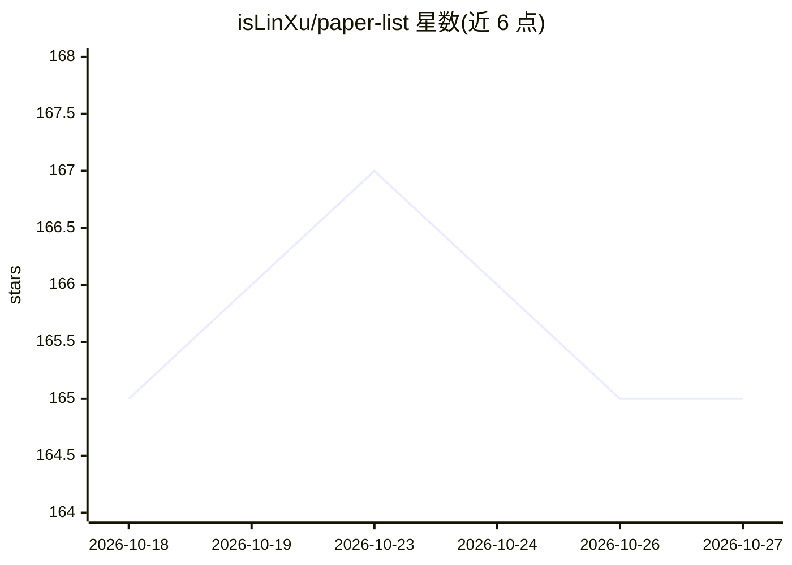

# isLinXu/paper-list

⭐ 165 · Python · Apache-2.0 · 推送 2026-10-26 · [GitHub](https://github.com/isLinXu/paper-list) · [官网](https://islinxu.github.io/paper-list/) · 个人维护

**自动追踪 arXiv 最新论文的每日聚合清单（20+ 主题）**

由 GitHub Actions 每 8 小时自动运行的 arXiv 论文追踪系统：从 Papers with Code API 拉取论文，补充 arXiv 链接、翻译服务、代码仓库等元数据，按 20+ 计算机视觉与 AI 主题分类，生成 GitHub README 与 GitHub Pages 双输出，并提供趋势图表、主题排行、作者榜等研究洞察。搜索关键词可通过 config.yaml 配置。面向需要按主题跟踪最新研究论文的科研人员与开发者。

## 筛选速览

| 维度 | 判定 | 备注 |
|---|---|---|
| AI 角色 | `ai-knowledge` | 知识聚合/清单类 |
| 许可风险 | `permissive` | Apache-2.0 |
| 部署形态 | `None` |  |
| 模型依赖 | — | README 未给出锁定关系 |
| 硬件要求 | — | 无带数字的原话,不猜 |
| 安装摩擦 | `low` | 无编译、无系统依赖或容器化 |
| 成熟度 | — | 结构信号不足 |

## 能力要点

- GitHub Actions 每 8 小时自动抓取并更新论文列表
- 覆盖 20+ CV/AI 主题，按月归档组织
- 自动附加 arXiv PDF、翻译、alphaXiv 讨论与代码链接
- 研究洞察面板：趋势图、主题排行、高产作者、代码覆盖率

## 适用场景

- 按研究主题每日跟踪 arXiv 新论文
- 查看各研究方向的热度趋势与代码开源比例
- 非英语读者通过翻译链接阅读论文

## 场景标签

`科研工具` `精选清单` · 领域:学习与行业

## 证据(README 行号)

> L15: **Paper-List-DAILY** is an automated arXiv paper tracking system that fetches, categorizes, and organizes the lates
> L17: Every day, GitHub Actions automatically polls the Papers with Code API, enriches paper metadata with arXiv links, t

## 星数曲线

2026-10-18 165 → 2026-10-27 165（+0）

---
*卡片 v1 · prompt 1.4 · 生成 2026-10-23 · 置信度 high · 依据 README sha `daa02a583efd` · [字段定义](../../DATASET.md)*
