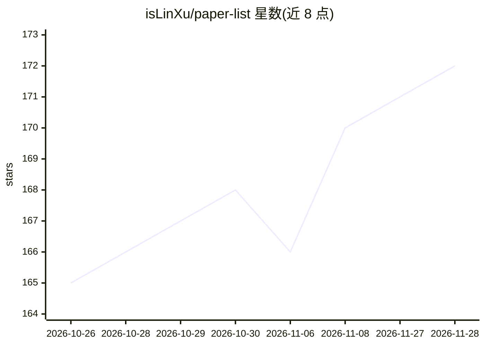

# isLinXu/paper-list

⭐ 172 · Python · Apache-2.0 · 推送 2026-11-27 · [GitHub](https://github.com/isLinXu/paper-list) · [官网](https://islinxu.github.io/paper-list/) · 个人维护

**自动追踪并按主题归类 arXiv 最新论文的每日更新清单**

由 GitHub Actions 每 8 小时自动运行的 arXiv 论文追踪系统：从 Papers with Code API 抓取论文，附加 arXiv PDF、翻译、代码仓库与 alphaXiv 讨论链接，按 24 个 CV/AI 主题生成 Markdown 列表并同步输出到 GitHub README 与 Jekyll 静态站点。提供趋势图、主题排名、作者榜与代码覆盖率分析面板，关键词过滤通过 config.yaml 自定义。需 Python 3.10+，支持 fork 后自建。

## 筛选速览

| 维度 | 判定 | 备注 |
|---|---|---|
| AI 角色 | `ai-knowledge` | 知识聚合/清单类 |
| 许可风险 | `permissive` | Apache-2.0 |
| 部署形态 | `None` |  |
| 模型依赖 | — | README 未给出锁定关系 |
| 硬件要求 | — | 无带数字的原话,不猜 |
| 安装摩擦 | `low` | 无编译、无系统依赖或容器化 |
| 成熟度 | — | 结构信号不足 |

## 能力要点

- GitHub Actions 每 8 小时自动抓取并更新，无需人工干预
- 覆盖 24 个 CV/AI 研究主题，按月归档
- 自动附加 arXiv PDF、翻译、阅读与代码链接
- ?view=agent 紧凑阅读模式与三套可切换主题

## 适用场景

- 每天浏览特定研究方向（如目标检测、扩散模型）的最新论文
- 搭建自己的按主题分类的论文追踪站点
- 查看某领域的高产作者与代码开源覆盖率趋势

## 场景标签

`科研工具` · 领域:学习与行业

## 证据(README 行号)

> L15: **Paper-List-DAILY** is an automated arXiv paper tracking system that fetches, categorizes, and organizes the lates
> L17: Every day, GitHub Actions automatically polls the Papers with Code API, enriches paper metadata with arXiv links, t

## 星数曲线

2026-10-26 165 → 2026-11-28 172（+7）

---
*卡片 v1 · prompt 1.4 · 生成 2026-11-28 · 置信度 high · 依据 README sha `eb36cd5c1ce2` · [字段定义](../../DATASET.md)*
